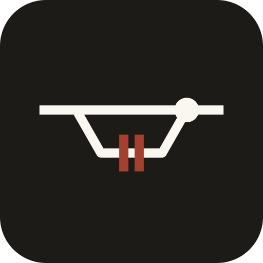

# po-kit

`po` is a small command-line tool for running a software backlog one item at a
time, with a gate, evidence and a clean git history. It scripts the mechanical
parts of a gated, one-item-one-commit workflow, so the people and coding agents
working the backlog run instruments instead of re-deriving the procedure each
time: open an item in its own worktree, stamp the gate's result, check the
branch is fresh, close the item (fast-forward, tag, record), and prune.

It suits a workflow with a product owner (a person or an agent) who opens and
closes items, and developers (people or agents) who each work one item in its
own branch and worktree. It is opinionated: one item is one commit is one tag.
See AGENTS.md for the dev/PO cadence, including the rule that an item changing behaviour updates or deletes the tests that pinned it.

Three laws, non-negotiable:
- **Dry-run is the default mode, not a flag.** Nothing writes without
  `--commit`; a full dry-run pass leaves `git status --porcelain` empty.
- **Manifest-driven.** Everything project-specific lives in the adopting
  repo's `po.toml`; the same scripts serve every project.
- **Never pushes, never writes prose.** The only words the kit ever edits
  are an item's STATUS tokens, wherever the backlog keeps them: a table
  cell, a status word in backlog prose, or a spec heading's status word.
  Close records, rulings, founding text and decisions stay human.

## Why it saves tokens

An AI coding agent pays for its whole working context on every step it takes:
each tool call re-sends the conversation so far, typically tens of thousands of
tokens, while the command's own output is a few hundred. So what a workflow
costs is mostly the **number of steps**, not the size of each step.

Done by hand, the boundaries of an item are many small steps: check the branch,
compare it with main, run each gate leg, count the tests, edit the backlog, commit,
fast-forward, tag, remove the worktree, delete the branch. Each one is a model
round trip, and each is a chance to get something slightly wrong (a missed status,
a mistyped tag, a hand-copied test count), which costs more round trips to notice
and repair. po turns each boundary into one command plus its dry run, with the same
result every time, and refuses instead of half-doing. The agent spends its steps on
the item itself.

How much that saves depends on your agent, model and context size. To measure it
for your setup, run one boundary twice on throwaway clones, once with po and once
by hand from the same instructions, and compare the two sessions' token counts.

## Requirements

- Linux (or WSL). bash 4.4 or newer, GNU coreutils (`stat -c`, `readlink -f`,
  `sort -V`) and a recent git (tested with git 2.56). Nothing else: no network, no services.
- macOS is not supported yet: its stock bash 3.2 and BSD tools differ. With
  Homebrew's `bash` and `coreutils` first on `PATH` it may work, untested.
- `python3` (3.8 or newer, standard library only) for `po serve`.
- `gtk4` and `python-gobject` (`pacman -S gtk4 python-gobject`) only for `po-dashboard`, the desktop viewer.
- `shellcheck` only to run the kit's own lint.

## Install

```sh
git clone https://github.com/MK-xOne/po-kit-for-ai-agent.git ~/src/po-kit
ln -s ~/src/po-kit/bin/po ~/.local/bin/po      # or: ~/src/po-kit/bin/po-install
po version
```

`bin/po-install [<tag>]` installs a tagged version in its own worktree and
points `~/.local/bin/po` at it, so work in progress on the kit's main branch
is never the live `po`.

## Quick start

1. Copy an example manifest to your repo root as `po.toml` and adjust it:
   `examples/rust.po.toml` (cargo) or `examples/python.po.toml` (pytest).
2. Keep a backlog table in `docs/BACKLOG.md` with an item column and a
   `Status` column (`TODO`, `DOING`, `DONE`, ...), and item specs whose
   headings read `## v1.2 — Title — STATUS` in `[layout] specs_dir`.
3. `po status` shows open items. `po open next "Title"` (dry run) shows what
   founding the next item would do; add `--commit` to do it. In the item's
   worktree, `po stamp` runs the gate and prints the evidence block;
   `po close <version> --commit` lands it.

## Usage

```sh
po [-C <repo>] [--manifest <file>] status [--idle <minutes>]
po [-C <repo>] [--manifest <file>] prune [--commit]
po [-C <worktree>] [--manifest <file>] stamp [--bin <path>]
po [-C <repo>] [--manifest <file>] fresh <version>
po [-C <worktree>] [--manifest <file>] report [--note <text>]...
po [-C <repo>] [--manifest <file>] open <version|next> [<title>] [--for <name>] [--epoch] [--body-file <f>] [--commit]
po [-C <repo>] [--manifest <file>] close <version> [--next <version> [--next-title <title>] [--for <name>]]
                                         [--also-done <version>]... [--body-file <f>] [--commit]
po [-C <repo>] [--manifest <file>] kickoff <version>
po [-C <repo>] [--manifest <file>] setup list [--item <version>] [--all] [--json]
po [-C <repo>] [--manifest <file>] setup confirm <version> <n> --by <who>
po [-C <repo>] [--manifest <file>] setup record <version> [--commit]
po [-C <repo>] [--manifest <file>] release <N> --setup | --write
po [-C <repo>] [--manifest <file>] team [--json]
po [-C <repo>] [--manifest <file>] serve [--bind <addr>] [--port <n>]
po version
po doctor
bin/po-install [<tag>]
```

The manifest defaults to `po.toml` at the root of the repository's main
worktree; `examples/` has two to start from. po always works from the
main worktree and reads the backlog as committed on `main`, so it answers
the same from any worktree.

- `[layout] owner_column` — an optional manifest key naming a backlog table
  column (`"Owner"`, matched exactly like `Status`). Absent, every command
  behaves as before, byte for byte. Set, the owner of an item is the cell of
  that column in its table row: `po open` and `po close --next` use it for
  the admin subject's `… for <owner>` when `--for` is absent, a `--for` that
  differs from a non-empty cell refuses with exit 3 and writes nothing, an
  empty cell with no `--for` names no owner, `po status` prints `owner
  <name>` under each DOING and held item, and `po kickoff` prints an `owner
  <name>` line. A table without that column gives no owner; a header naming
  it twice is an error (2); an empty `owner_column` is a manifest error (2).
- `po status` — DOING and held (PAUSED/BLOCKED) items from the backlog
  tables and the spec-file headings, each with its branch (ahead/behind
  main) and worktree (dirty count); the latest tag; orphaned and dirty
  worktrees; unmerged branches no open item claims. Exits 3 when the
  backlog's sources disagree about an item. `po status --json` prints only the DOING
  items, `[{"item": "0.9", "idle_hours": 3}]`: `idle_hours` is the idle time below in whole hours
  (rounded down), `null` with no worktree; a feed producer copies it into the projects feed.
  Each DOING item's branch line ends in `idle 3h12m`: now minus the newest
  of the branch tip's commit date, the newest `gate-<n>.txt`, and the
  newest mtime among the worktree's changed and untracked files (`idle -`
  with no worktree). `--idle <minutes>` also lists the DOING items idle
  longer under `IDLE (n)` and exits 8 after printing everything; without
  it the exit codes are unchanged (3 outranks 8). Read-only.
- `po ready` — the ready list from backlog status. Reads the repo's
  candidate file (`[ready] file` in po.toml, JSON lines
  `{item, title?, agents[], depends[], needs_note?}`; one repo may point at
  a shared file with a `project` field filtered by `[project] name`) and
  prints only items that can run now: the item's status on main is TODO (a
  DONE, DOING, HELD, PAUSED, BLOCKED item or an item absent from the backlog
  is never listed), every `depends` item is DONE, and `needs_note`, when
  present, names a repo path (a design note) that must exist on main; a line
  is later overridden by a corrected line for the same item (last wins).
  `--json` prints a JSON array; `--explain` prints per-candidate exclusion
  reasons to stderr. Exit 0 always for a readable list; a malformed line is
  reported with its line number and skipped. Read-only.
- `po prune` — worktrees and branches merged into main, minus the main
  worktree, open items' branches, and anything dirty, locked or outside
  `[layout] worktrees` (each listed with its reason). `--commit` removes
  them with `git worktree remove` (never `--force`) and a compare-and-delete
  of each branch ref.
- `po stamp` — runs the gate in the current worktree (`[gate.legs]` in
  order, or `[gate] command` as one leg), takes the count, and
  prints the evidence block:

  ```
  HEAD <sha> (<branch>)  dirty <n>
  gate PASS: check/test/clippy/fmt   tests <n> passed
  diffstat vs merge-base(main): <summary>
  prepare ran: <line>               # one per [stamp] prepare line
  bin sha256 <hash> (<path>)        # with --bin
  ```

  Optional `[stamp] prepare` lines run first (see below), so a format-only
  failure cannot happen.

  The count is the sum of every libtest `test result: ok. N passed` line
  (or pytest's summary) the count source prints, and must equal the gate's own
  when the gate prints any. When a leg is named `test`, its saved output is the
  count source and the suite runs once; `test_count_cmd` is then optional and
  only a filter: the saved output is piped to it on stdin, and it never reruns
  the suite (a command that ignores stdin, such as `cargo test 2>&1`, still
  reruns it, so drop it or turn it into a filter). The count is then checked
  against the `test` leg's own summaries only: another leg that prints one
  (doc tests, integration) is not added in. With no `test` leg,
  `test_count_cmd` is required and is the counting run, as before. The block is also written to `gate-<n>.txt` at the
  worktree root, `<n>` one past the highest there; nothing is ever
  overwritten. All or nothing: a failing leg (named), a missing or
  disagreeing count, a non-ok summary, or a worktree that changed while
  the gate ran exits 4 and writes no file. `dirty` and that last check
  ignore the stamp files themselves; don't commit them.

  A failed run keeps its evidence outside the worktree. Its event (see
  `po events`) gives the failing leg a `tail`: the last 40 lines of that
  leg's output, each cut at 400 characters. The whole run's output (the
  reason, then every command that ran, under its command line and exit
  code) goes to `po-logs/stamp-<UTC time>-<item>-<pid>.log` in the
  repository's common git dir; the event's `log` key names it and stderr
  says where it is. Both are redacted first, best effort: the value of every
  environment variable whose name says it is a secret (`TOKEN`, `SECRET`,
  `PASSWORD`, `PASSWD`, `API_KEY`, `PRIVATE_KEY`, `ACCESS_KEY`, `CREDENTIAL`,
  `AUTH`, `NSEC`), is 8 characters or more and is not an absolute path, the value after a key of that
  kind (`token=...`, `password: ...`), an `Authorization` header's value
  (up to a quote or semicolon),
  `Bearer` and `Basic` credentials, a URL's user and password, tokens of
  well-known shapes (`ghp_`, `github_pat_`, `glpat-`, `sk-`, `xox?-`, `AKIA`,
  `nsec1`) and every line of a PEM private key become `[REDACTED]`, and
  terminal colour codes are dropped. A secret of no known shape under a name
  that does not say so passes through, so a gate should not print one. The
  event's `detail`, which names the failing leg's command, is redacted the
  same way. `po-logs/` is never pruned: po never deletes a log; remove old
  ones by hand.

  With `[gate] test_format = "pytest"` (default `"libtest"`) the count is
  instead the `N passed` of the last pytest summary line the output has
  (`223 passed in 1.23s`, `== 3 passed, 1 skipped in 0.5s ==`), counted per
  leg and cross-checked the same way. A summary naming `failed` or
  `error`/`errors`, or no passed tests, exits 4; so does output with no
  pytest summary.

  A line `RUN-ABORTED` in a leg's or the count command's output exits 4, and
  with `[gate] run_sentinel = "required"` so does a count command whose output
  has no `RUN-END ...` line (a test runner prints it last but for its summary).
  A count command that pipes the runner should keep the runner's exit code
  (`bash -o pipefail -c '...'`).

  A command that leaves a process behind cannot hang the stamp. Each command
  (every leg, every `[stamp] prepare` line and the count command) is read
  until it exits itself; the output is then given `[gate] drain_secs` more
  (default 5) to arrive, and reading stops. When `systemd-run` and a user
  systemd are available, the command also runs in a transient user scope
  (`po-stamp-<pid>-<ns>`); once it exits, the processes still alive in that
  scope are listed and the scope is stopped (a process that ignores SIGTERM
  is killed after 2 seconds), and the stamp fails with `po stamp: <n>
  process(es) left behind by <leg>: <names, first 10>`, nothing written, the
  command's real exit code and output in the log. A command that leaves
  nothing behaves as before. Without `systemd-run` the commands run unscoped
  and one warning says leftovers are not detected; `PO_STAMP_NO_SCOPE=1` or
  `[gate] scope = false` turns the scope off (the grace stays).
- `po fresh <version>` — the item branch (`[layout] branch`) against the
  local main: ahead/behind, the merge-base, and every main commit since
  it, oldest first, classed ADMIN (`admin_prefix`), ITEM vX
  (`item_commit` form) or OTHER, and marked RULING / RULES when it
  changes `[docs] decisions` / `rules`. Exit 0 and `FRESH` when main is an
  ancestor of the branch; exit 5 and `REBASE REQUIRED` when it is not.
  Read-only: it never fetches, rebases or writes. A remote-tracking main
  that differs from the local one is noted, not judged.
- `po close <version>` — the closing boundary. Pre-flight, all before any
  write: every backlog source says the item is DOING and none disagrees
  (else exit 3); its branch is exactly one item-form commit on main (6);
  `po fresh` passes (5); the newest `gate-<n>.txt` in its worktree names
  the branch tip, `dirty 0`, `gate PASS` (6); its tag is free (6). Then, with
  `--commit`: fast-forward main; a lightweight tag (written with
  `update-ref`, so `tag.gpgSign` never turns it into a signed one) or,
  with `[versioning] tag_style = "annotated"` (default `"light"`; any other
  value is a manifest error, exit 2), an annotated one (`git tag -a`, message
  `<tag>: <title>`, signing as the repo's git config says — po adds no `-s`;
  a tag that cannot be created stops the close there, naming what is owed),
  still create-only and at the item commit; the
  backlog edits as the `admin:` commit, author from git's own config, the
  stamp block quoted in its body (`--body-file` appends more); the
  `--next` item's branch and worktree at that commit; the closed item's
  stamp files, worktree (`git worktree remove`, never `--force`; kept and
  reported when it holds ignored files) and branch. `--next` takes a TODO
  item DOING, or with `--next-title` founds a new number (same law as
  `po open`); `--also-done` closes an investigation (DOING, no commits)
  in the same commit, with no merge and no tag. A no-change item (its
  branch has no commit main lacks, its worktree is clean, and the newest
  stamp names that tip clean and passing: the claim "no change needed" is
  stamped, not typed) closes with no fast-forward: the admin commit is
  written first and the tag goes on it (annotated message `<tag>: <title>
  (no change needed)`); the dry run says "no change: the tag goes on the
  admin commit", and the hook's `PO_ITEM_COMMIT` is the admin commit.
- `[hooks] on_close` — an optional manifest command (`sh -c`) that
  `po close --commit` runs once the whole boundary is complete (ff, tag,
  admin, `--next`, prune), in the main worktree with stdin `/dev/null` and
  its output passed to stderr. Environment: `PO_HOOK=on_close`,
  `PO_VERSION`, `PO_TAG`, `PO_TITLE`, `PO_ITEM_COMMIT`, `PO_ADMIN_COMMIT`,
  `PO_DATE` (the admin commit's author date, ISO 8601), `PO_EVIDENCE` (a
  temporary file holding the stamp block, removed afterwards),
  `PO_BODY_FILE` and `PO_NEXT` (empty when not given), `PO_REPO`. A dry run
  lists the command and environment and runs nothing; a refusal or partial
  failure runs no hook. A non-zero exit warns and makes `po close` exit 7
  — the boundary stands, nothing is rolled back. No `[hooks]`, no change.
- `po report [--note <text>]...` — the item report, read-only, run in an
  item worktree. One markdown block: `<tag> report — <branch> at <short
  HEAD>`; `Files changed:` with a line per `git status` entry (code and path in backticks; stamp files left out) and, when the branch is ahead of main,
  the item commit's files marked `(committed)`; the newest `gate-<n>.txt`
  verbatim between fences; and `PROPOSED:` with each `--note` numbered, in
  order (the caller's words, passed through). Fresh stamp only: with no
  stamp, a newest one naming another HEAD or another dirty count, or any
  changed file newer than it, it exits 4 and prints nothing on stdout. It
  never runs the gate and posts nothing; the tag comes from the branch
  name via `[layout] branch`.
- `po events [--all] [--json] [--archived]` or `po events --archive-now` — the gate event log, read-only (but for `--archive-now`). `po stamp`
  appends one event per run, pass or fail, and `po open` and `po close` one
  each after a complete `--commit`, to `po-events.jsonl` in the repository's
  common git dir (shared by every worktree, never tracked, never dirt).
  One JSON object per line: `time` (ISO 8601, UTC), `kind` (`stamp`, `open`,
  `close`), `item` (null off an item branch), `project` (the checkout's
  directory name), `result` (`pass`, `fail`), `agent` (`$BUZZ_AGENT`, else the
  user), `legs` (each leg's `name`, `result`: `pass`, `fail`, or `skip` when
  an earlier leg failed, and, on a stamp, `seconds`), for a stamp the run's
  own `seconds`, and `detail` (why a stamp failed). A failed stamp
  also has the failing leg's `tail` (its last 40 lines, redacted, one string
  with `\n` between lines) and `log` (the absolute path of the run's full
  output, null when it could not be written); see `po stamp`. Logging never
  changes a command's exit status or output; a log that cannot be written
  warns on stderr. `po events` prints the last 10, newest first, as a table
  in the viewer's local time, then, under it, each listed failed stamp's
  tail, indented, under a line naming the leg and the log; `--all` prints
  every event in the live log; `--json` prints the stored lines (UTC) for machines; the two
  combine.

  **The live window and the archive.** The log keeps the last `[events]
  live_days` days (default 10). Older events move to `po-events-archive.jsonl`
  beside it in the git dir, whenever a `po stamp`, `po open` or `po close`
  appends an event and when you run `po events --archive-now` (which prints
  how many moved). The move never touches an event inside the window, and an
  event whose `time` is not a UTC stamp stays live. It is one atomic rewrite:
  the archive is appended first (a line already in it is skipped), then the
  live log is replaced by a rename of a temp file, so a crash loses nothing and
  a rerun adds no duplicate. `po events` and `po events --json` show live
  events only; `po events --archived [--json]` shows the archive, newest first.

  **Time taken.** A stamp event records whole seconds of wall clock: each
  leg's `seconds` (from the leg starting to its exit; a leg not reached has
  `seconds` 0; the `prepare` leg is the time of its lines) and, after `legs`,
  the run's `seconds` (prepare plus legs; the test-count command is in the
  run, not a leg). Older events, and open and close events, have no
  `seconds`: every reader treats that as unknown, never 0. `po events` adds a
  `TOOK` column (`57s`, `4m12s`, `1h02m03s`, `-` when unknown), shows each
  leg's time after its result (`test:pass(4m09s)`; no suffix when unknown),
  and prints the word `slow` after the time of a run over `[stamp]
  slow_after`; `--json` carries the raw keys. The mark is information only:
  no exit code changes. **The trigger:** when a gate goes over about 5
  minutes (the `slow` mark), the PO specs a fast per-item gate and runs the
  full suite nightly and before each release. Those tiers are not built.
- `po open <version|next> [<title>]` — the founding boundary. A new number
  must be latest founded + 1 (`next`), an epoch step with `--epoch`
  (1.10.0, 2.0.0), or the next insert in the `insert_segment`-th segment
  under a founded item; its heading `## <tag> — <title> — DOING` goes into
  the spec file of the closest lower version, before the first higher
  heading. A number already founded TODO goes DOING. With `--commit`: the
  edits as the `admin:` commit, then the branch and worktree at it.
- `po kickoff <version>` — the mechanical half of a founding brief,
  read-only. The item's spec section verbatim from main, between
  `SPEC SECTION <file>:<a>-<b>` and `END SPEC SECTION`: from its heading
  to the next heading of the same or a higher level (fenced code is not
  read for headings). The heading is the `## <id> — …` one the backlog
  parser reads; failing that, in a table-shaped ledger, any heading
  naming `item <label>`, the label being a cell left of the id in the
  item's table row (`| E | v0.5 |` finds `### … (item E — …)`). Every
  matching heading is printed. Then the `[docs] rules` pointer (its blob
  on main), and every admin or ruling commit on main from the previous
  boundary — the highest tag below the item reachable from its founding —
  to its founding, the oldest first-parent commit where a backlog source
  says DOING; each line is `po fresh`'s for that commit. An item not yet
  DOING is listed to main's tip; an open one also lists what main gained
  since its founding. The judgment layer stays the PO's. Exit 2 when a
  source is missing: no spec section (a founding in progress), no
  `[docs] rules`, or one not on main.
- `[kickoff] preamble` — an optional manifest key, a one-line array of
  strings (`preamble = ["Run pwd first.", "", "Read the rules."]`; an empty
  string is a blank line). `po kickoff` prints its lines verbatim at the very
  top of the brief, then a blank line, so a project's start-of-item steps are
  part of the prompt. Absent or `[]`, the output is byte-identical to before.
  A value that is not an array of quoted strings, or any other key under
  `[kickoff]`, is a manifest error (2); `po doctor` lists the key as
  `adopt [kickoff] preamble` for a manifest without it.
- `[close] checklist` — an optional manifest key, a one-line array of strings
  (`checklist = ["Post the close message.", "Propose the episode."]`), the
  steps a project wants after every close. After a complete `po close
  --commit` boundary, before any `[hooks] on_close` command, po prints the
  lines under a `CHECKLIST` heading. With `--run-checklist` it also runs each
  non-blank line (`sh -c` in the main worktree, stdin `/dev/null`, output to
  stderr, `PO_VERSION`, `PO_TAG`, `PO_TITLE` and `PO_REPO` set), every line
  even if one fails; a failure is a warning and exit 7, the boundary stands.
  The dry run lists the checklist and runs nothing. Absent or `[]`, `po close`
  behaves exactly as before (and `--run-checklist` is a usage error without
  one). A value that is not an array of quoted strings, or any other key under
  `[close]`, is a manifest error (2); `po doctor` lists the key as
  `adopt [close] checklist` for a manifest without it.
- `[close] memory = true` — an optional switch (a bare `true` or `false`, no
  quotes; absent is off). On, `po close` prints a memory prompt line and
  `po close --commit` refuses unless the `--body-file` has a line starting
  `Memory:` with a proposal id, a `proposed` note or `nothing new learned`.
  A failed `po stamp` prints the same prompt after its failure lines whether
  the key is set or not; it never changes the exit code or the evidence block.
- `[close] require_setup = true` — an optional switch (a bare `true` or
  `false`, no quotes; absent is off). On, every item's spec carries a
  `Setup after install` section, written by the dev: the single word `None`,
  or a table with one row per step, in order:

  ```markdown
  ### Setup after install

  | # | Machine | Command | Who | Check |
  |---|---|---|---|---|
  | 1 | build host | `systemctl --user restart viewer` | operator | the viewer page shows the new tag |
  ```

  The heading is any level from `##` down (`###` inside an item's section of
  a shared spec file); the columns are exactly those five; steps are numbered
  1, 2, 3; Command is one backticked command, or `-` when the step is not a
  command (say what to do in Check); a `|` inside a command is written `\|`
  or sits inside the backticks. `po close` looks for the section at the item
  branch's tip, first in the item's spec sections (found as `po kickoff`
  finds them), then in any `.md` file the item's backlog row names in
  backticks. Missing or malformed: refused, exit 6, naming where it looked or
  the line at fault. Items founded before the switch was on are exempt: po
  reads the manifest at the item's founding commit (the oldest commit on main
  where the backlog says DOING), and if the switch was not on there, the close
  goes on and its plan says `setup     exempt: founded before [close]
  require_setup` (a manifest outside the repository, or no founding commit
  found, is never exempt). So turning it on is one admin commit, and every
  item founded after it needs the section. The plan prints `setup     None`
  or `setup     <n> step(s) (<file>:<line>)` after the evidence and a `SETUP`
  block grouping the steps by machine and who; `po kickoff` prints one line
  saying the section is needed. `po close --commit` records the steps as open
  in `po-setup-steps.json` in the common git dir (a write that fails is a
  warning and exit 7; the boundary stands, and `po setup record <version>
  --commit` writes them again from the item's tag, keeping confirmed steps).
  An exempt item with a well-formed section still has its steps recorded.
- `po release <N> --setup` prints the `### Setup after install` block of `CHANGELOG.md`'s
  `## Release N` entry (else `## Unreleased`), built from the recorded steps of the items the entry
  names (every `vX.Y` in it, ignoring a block already there): the word `None`, or the table
  `| # | Machine | Command | Who | Check |`, one row per step in item then step order, the item
  after the command (`(v0.9)`). A `|` in a cell is written `\|`; a command with backticks gets a
  longer code fence. `--write` inserts it right under the `## Release N` heading, or replaces the
  block there (idempotent); recorded steps are never edited. Under `[release] review = true` it
  refuses (6) without the review row, like `po release <N>`.
- `po setup list [--item <version>] [--all] [--json]` — read-only: the
  recorded steps still open (`--all` adds the confirmed ones, with who and
  when), one line each (`v0.9 #1  open  build host  operator  <command>`,
  then its `check:`); `--json` prints `{"steps": [{item, n, machine,
  command, who, check, status, recorded_at, confirmed_by, confirmed_at}]}`.
  `po setup confirm <version> <n> --by <who>` marks one step confirmed; it
  is run by whoever did the step, not only the PO; a step already confirmed
  says by whom and changes nothing; an unknown step is a usage error (1).
  Each confirm is logged as a `setup` event in `po events`. A projects feed
  producer can count each item's open steps into its `setup_open` field.
- `[stamp] prepare` — an optional manifest key, a one-line array of
  strings (`prepare = ["cargo fmt", "ruff format"]`), the deterministic
  fixes (formatters) a project wants applied before every gate. `po stamp`
  runs each non-blank line in order (`sh -c` in the worktree, stdin
  `/dev/null`) before anything else, then takes the worktree's state, so
  `dirty` and the unchanged-tree check count what the lines changed, and
  the gate tests the formatted tree. The block names each line that ran
  (`prepare ran: <line>`, after the diffstat); the event records them as one
  leg, `prepare`, ahead of the gate's legs. Test summaries a line prints
  are not counted. A line that exits non-zero fails the stamp like a gate
  leg: exit 4, nothing written, later lines and the gate not run, the
  `prepare` leg failed with its tail (the output of every line so far) and
  the full output in the stamp log. Absent or `[]`, `po stamp` is
  unchanged. A value that is not an array of quoted strings, or any key
  under `[stamp]` other than `prepare` and `slow_after`, is a manifest error
  (2); `po doctor` lists the key as `adopt [stamp] prepare` for a manifest
  without it.
- `[events] live_days` — an optional integer, days (default 10): events older
  than this leave `po-events.jsonl` for `po-events-archive.jsonl` (see `po
  events`). Anything but an integer is a manifest error (2); `po doctor` lists
  the key as `adopt [events] live_days` for a manifest without it.
- `[release] source` — optional, `"tag"`, `"github"` or `"none"` (default
  `none`): what counts as a release, read by `po released`. `tag` takes the
  newest tag matching `[release] pattern` (a git tag glob, default
  `release-*`; only with `tag`) by version order; `github` takes the tag the
  caller passes with `po released --release <tag>` (a feed producer reads the
  newest GitHub release; the kit never calls GitHub); `none` has no release.
  Another value, or `pattern` without `tag`, is a manifest error (2).
- `[gate] drain_secs` — an optional integer, seconds (default 5): how long
  `po stamp` keeps reading a command's output after the command has exited.
  Anything but an integer is a manifest error (2).
- `[gate] scope` — an optional `true`/`false` (default `true`): run each stamp
  command in its own transient user scope to detect processes it leaves
  behind. `false` (or `PO_STAMP_NO_SCOPE=1`) is for hosts without a user
  systemd.
- `[stamp] slow_after` — an optional integer, seconds (default 300): a stamp
  run that took longer is marked `slow` in `po events` and in the
  dashboard. Information only.
- The backlog edits both make are status words only — a spec heading's
  status word, a table row's Status cell, the one status word after the
  item's id in BACKLOG prose (`v1.9.11 parser TODO` → `DOING`; a close
  writes `DONE (tag vX)`) — plus a founding heading line. Each is anchored
  on the id and the status it expects; two candidates, another status or a
  status wrapped onto the next line stop with exit 3. Prose (close records,
  rulings, founding text) stays the PO's. Without `--commit` both print the
  whole plan — steps, the edits as a diff, the admin message, `--commit`
  readiness — and change nothing. Exit 6: refused by the item law.

- `po released [--json] [--release <tag>]` — the DONE items the project's
  latest release contains, judged from git, read-only: an item is released
  when its item tag (`[versioning] tag` filled) is an ancestor of the release
  tag (`git merge-base --is-ancestor`). A DONE item without an item tag is
  judged by its DONE commit instead: the newest `admin: <v> DONE` commit on
  main, else the newest commit that changed its backlog row or its
  `## <tag> — ...` heading in `specs_dir`; released when that commit is an
  ancestor of the release tag, not released when there is none. The release comes from `[release] source`
  (above). Prints `release: <tag>` (or `release: none`) and one released
  version per line; `--json` prints `{"source", "release" (null when none),
  "released": [versions]}`. `--release` is for source `github` only (exit 1
  otherwise); a tag given that is not in the repository is exit 2 (fetch tags
  first). A feed producer uses it to fill the projects feed's `release` and
  `released` fields.
- `po release <N> [--open-review] [--commit]` — under `[release] review = true` (a bare `true` or `false`; absent is off) it refuses, exit 6, unless the backlog has a TODO, DOING or DONE row titled `test review: ... release-N`; `--open-review` adds that row as an admin commit (a dry run without `--commit`, idempotent); with the key off and no flag it prints nothing.
- `po team [--json]` — the feed the dashboard Team view reads
  (`--team-url`, below), built from what the kit knows, read-only. The roster is
  the manifest's `[[team.agent]]` tables, in file order: `name` (required,
  unique, matched without regard to case), optional `model` and `role`.
  Per agent it prints `{agent, model?, state, now, owns[], working_on?, free,
  limit_until?, usage?}` (`--json`: one JSON array; otherwise a table). `state` is
  `WORKING`, or `idle <time>` (`22m`, `3h`, `2d`; `idle never` with no event)
  from the age of the agent's newest event in the gate event log (`BUZZ_AGENT`
  or the user name is the event's agent). `owns` is the open items (DOING,
  PAUSED, BLOCKED) whose `[layout] owner_column` cell names the agent, by
  version; without that key nobody owns anything. `working_on`, when present,
  is the agent's current item: it splits `owns` into `working on:` and
  `parked:` in the Team view; absent, the whole list is shown as `owns`. An
  agent is `WORKING`, with `now` its lowest-numbered DOING item, while it owns
  a DOING item and its newest event is under 15 minutes old. `free` is true
  for an agent that is not WORKING and either owns nothing, or has been idle
  15 minutes or more with every owned item held (PAUSED or BLOCKED, waiting
  on someone else); an agent with a DOING item is never free. An idle agent
  with owns is marked `idle, owns N items`; a missing or non-array `owns`
  field is treated as empty. Host facts are
  not probed: `[team] limits_file` (a JSON object, agent to an ISO time or
  `null`) and `usage_file` (agent to `{five_hour, seven_day}`, numbers) are
  merged into `limit_until` and `usage` when the files exist; a missing file
  is ignored, an unreadable one warns on stderr and is left out (both need
  `python3`; paths are relative to the main worktree). An empty roster is an
  error (2).
  `po serve` exposes the same array at `/team.json`. `examples/team.po.toml`
  is a sample roster.
- `po dispatch --plan | --commit` — gives the ready items to the free eligible
  agents. For each item of `po ready --json`, in that order, the first agent of
  `po team --json` that is `free` and eligible gets it: an item whose `agents`
  list is non-empty is eligible only to those names (case-insensitive), one
  with no list to any roster agent. Candidates are tried in the order of
  `[dispatch] order` (a one-line array of names, cheapest first; agents not
  named come after, in roster order). An agent gets at most one item per run,
  and an agent that is not free (WORKING, or owning an item) never gets one.
  `--plan` prints one `assign <item> to <agent>` or `skip <item> <reason>` line
  per ready item (`no free eligible agent`, `no roster agent is eligible`) and
  changes nothing. `--commit` runs `po open <item> --for <agent> --commit` for
  each assignment with `BUZZ_AGENT=dispatcher`, so the open events carry the
  agent `dispatcher` (a fixed name); a failed open is reported (`FAILED`) and the
  run goes on, then exits 6. After each open it writes the item's prompt (a
  first line `<item> → <agent> · PROMPT`, then `po kickoff`) to
  `<git dir>/po-dispatch/<item>.md` and runs the optional `[dispatch] notify`
  command (`sh -c`, in the main worktree) with three arguments: the item, the
  agent and the prompt path; the kit knows no chat, a wrapper command posts
  the message. A second run finds the opened items DOING and opens nothing
  twice. `po open <item> --for <agent>` writes the agent into the item's
  empty `owner_column` cell in its own admin commit (a cell already naming
  another agent is refused, exit 3), so `po team` sees the agent as busy and
  a repeated run gives no agent a second item. Needs `python3`.
- `po lint-founding [--ready <file>] [--project <name>] [--agents <a,b>]` — read-only check of what a founding commit left on main, one `file:line: finding` per line, exit 0 clean (no output) or 1 with findings: a backlog row or item heading without its status as one ALL-CAPS word; an open item without a spec heading under `[layout] specs_dir` (skipped when it is `.`); a ready-file line (`[ready] file` or `--ready`) that is not valid JSON, names an item absent from the backlog or HELD, PAUSED or BLOCKED, names an agent outside the roster, `[dispatch] order` and `--agents`, or repeats an identical line. DOING and DONE lines are history and pass; the last line for an item wins.
- `po serve [--bind <addr>] [--port <n>]` — a small read-only web viewer of the
  gate events, for a screen you leave open. `/` shows the last 10 events, newest on top,
  one row each: result (symbol and word), item, project, kind, checks (each
  gate leg and its result), agent, took (the run's time, `-` when unknown,
  in the warning colour when over `[stamp] slow_after`; `po serve` reads the
  threshold from po.toml, `PO_SLOW_AFTER` sets it for `po-dashboard`, default
  300), time, and a note icon when the event has a
  detail (its tooltip and aria-label are the detail, then, for a failed
  stamp, the failing leg's tail and the log's path); each row links to `/all`,
  the full list, in the same layout; `/events.json` is the same data as JSON (live events only; it answers with an `ETag`, a hash of the whole feed, and `304 Not Modified` with no body to a matching `If-None-Match`; `?since=<time>` returns only the events at or after that time, and those with no time, marked `X-Po-Since: partial`, while a request without it is marked `X-Po-Since: full`, so `po-dashboard` fetches it conditionally and incrementally), `/archive.json` the archive in the same shape (`po events --archived --json`, read-only, on the same loopback rule), and `/team.json` is `po team --json`. The pages poll it every
  few seconds and redraw in place; times are UTC in the data and shown in the
  browser's local time. Every field is HTML-escaped. It reads events only by
  running `po events --json` (so it needs a po that has `po events`) and needs
  `python3` (standard library only). GET only: any other method is 405. It binds
  `127.0.0.1` (port 8765) unless told otherwise, and refuses `0.0.0.0`, `::` and
  any name that resolves to them (exit 1): name one address, e.g. a VPN
  interface's. There is no login, so bind only to an address whose reachers you
  trust. It prints `po serve: listening on http://<addr>:<port>/` and runs until
  stopped; `--port 0` picks a free port.

  **The web view, `/app/`.** The same server also serves a phone-ready page: one HTML, one CSS and two
  JavaScript files from `share/po-web/` (no framework, no build step, no CDN, no external request; it
  works from its own files). It opens on **Decisions**, with a toggle Decisions, Events, Projects, Team
  and a count on each (`Decisions (2)`, `Events (5 today)`, `Projects (3)`, `Team (1 working)`); the
  chosen view is kept in the address (`#team`) so a reload returns to it. A decision card shows its kind,
  title, who waits and `asked 12m ago`, collapsed to that header until tapped, with a choice's options
  listed and the recommended one marked, and ends in an `Open thread` link (its `thread_url`; a card with
  no answer form says to answer there). Decisions sort as on the desktop: Choices, then Actions, then the
  rest, oldest asked first. An Events card's head names its newest event's result (`✔ pass`, `✘ fail`) and
  kind; Team writes a bare version as `v0.141` and a `project v1.2` value as it is. It lays out for a 360 px
  screen (44 px tap targets, no sideways scroll) and in columns on a wide one, follows the system's light
  or dark scheme, refreshes every 10 s with `If-None-Match` (a hidden tab pauses), and when a fetch fails
  keeps what it has and shows `not updated 5m ago`. Feed text is only ever written as text, never as markup.
  The page reads the feeds through `po serve` itself (`GET /app/feeds/<name>.json`, same origin, GET only),
  forwarding to the one URL `po.toml` names for each:

  ```toml
  [serve.web]
  decisions_url = "http://127.0.0.1:8790/decisions.json"   # each optional; no URL hides that view
  projects_url = "http://127.0.0.1:8790/projects.json"
  team_url = "http://127.0.0.1:8790/team.json"
  events_url = "http://127.0.0.1:8790/events.json"         # none: po serve's own events
  answer_url = "http://127.0.0.1:8791/answers"             # only its origin is added to the page's policy
  ```

  (`examples/web.po.toml`). Only `If-None-Match` goes up to a feed, and `?since=` on events; the upstream's
  `ETag`, `X-Po-Since` and 304 come back, and an unreachable or non-JSON feed is a 502 with `{"error": ...}`.
  `/app/config.json` lists the feeds and `answer_url` for the page. Every `/app/` answer carries a
  `Content-Security-Policy` that allows only the page's own files and the one `answer_url` origin,
  `Referrer-Policy: no-referrer` and `nosniff`; any method but GET is 405. The page's files are served from the
  `share/po-web/` of the checkout running `po serve`, with an `ETag` and 304. `/`, `/all` and the JSON feeds are
  unchanged. There is still no login: bind to an address whose reachers you trust.

  **Answering from the page.** With `answer_url` set, an expanded Choice card gets its options as a stacked
  radio group (long labels wrap) and an `or write your own` box, an Action card Pass or Failed (with the step
  it failed at) and a note, and a Send button that stays in view at the bottom of a small screen. Send posts
  the same JSON body as the desktop viewer's (see "Answering decisions" below; `client` is `po-dashboard`) to
  `answer_url`, with the device token as `Authorization: Bearer`. The token is entered once with the header's
  `Set device token` button and kept in the browser's storage for the page's origin; once it is set the button
  becomes a small `device token set · change` link beside the views, the page never shows the token, and sends it
  nowhere but `answer_url`. A draft (the pick and the text)
  is kept per card across refreshes and reloads; while the pick is unchanged a new Send reuses the same
  `answer_id`, so a retry after a lost reply posts nothing twice. Send is disabled from the tap until the
  reply. The card then shows `sent 3:41 PM` and leaves the list with the next feed; `already answered` (409),
  `no longer waiting` (404), `not sent: refused (401), check the device token`, `not sent: rate limit` (429),
  or `not sent: <class>` when the sink cannot be reached (the draft is kept). A browser cannot tell an
  unreachable sink from one that refused its preflight, so that case reads `not sent: unreachable or refused`.
  A look card (an action with `requires`) is shown, and so answerable, only when its ready check passes, as in
  the desktop viewer; its answer names the build the install machine reported. Cards with no answer form
  (unformatted) say to answer in their thread. The page and the sink are two origins: the sink must answer
  the browser's `OPTIONS` preflight for the page's origin (`Access-Control-Allow-Origin` that origin,
  `Allow-Methods: POST`, `Allow-Headers: Authorization, Content-Type`) and expose `X-Reason`, and must refuse
  any other origin.
- `po-dashboard [--url <url>] [--archive-url <url>] [--team-url <url>] [--decisions-url <url>] [--projects-url <url>] [--view events|team|decisions|projects|reports] [--project <name>] [--theme auto|light|dark] [--all] [--size WxH] [--check] [--screenshot <png>] [--screenshot-delay <s>]`
  (`bin/po-dashboard`, not a `po` subcommand) — a desktop window for the same
  events: the last 10 as flat single-line rows in one raised panel, a hairline between rows (result, item, project,
  kind, checks, agent, took (sortable like the others; `-` when unknown,
  the warning colour when slow), time in the local zone, note) in fixed columns that line
  up from card to card, long values ellipsized with the full text as a tooltip,
  the project and checks columns widening with the window, and a note icon for
  an event with a detail (tooltip and accessible label are the detail, with
  a failed stamp's tail and log path as in `po serve`; an
  event without one leaves the slot empty), a "Show all" toggle for every event (in the
  second button row, below), a
  refresh every 5 seconds. The URL is the events JSON, for example the
  `/events.json` of a `po serve`; `--url` or `PO_DASHBOARD_URL`, with no
  default, and neither is an error (exit 1). It accepts a JSON array or one
  object per line. An unreachable URL shows an error line and keeps the last
  data. Every feed (events, team, decisions, projects) is fetched every 5
  seconds, but a feed whose last fetch is still in flight skips that tick, so a
  slow server never has two fetches of one feed running. Fetches are
  conditional: the window sends `If-None-Match` with the `ETag` of the body it
  last accepted, and a `304 Not Modified` leaves its data as it is (nothing is
  downloaded or parsed again). A server that also takes `?since=<time>` on the
  events feed says so with the header `X-Po-Since: full` on every answer; the
  window then asks for `?since=<newest event time it holds>`, the server answers
  with only the events at or after that time and `X-Po-Since: partial` (its
  `ETag` stays the whole feed's), and the window adds the ones it does not hold
  yet. Every 60th fetch is whole, so events that left the server's live window
  drop. A server without `ETag` or `X-Po-Since` (a file, an older `po serve`)
  is fetched whole each time, as before. `examples/events-demo-server.py`
  shows the headers on its `/events.json`. The window has the desktop's own title bar and a neumorphic style (GTK
  CSS, one base colour per variant): one raised panel per list (Events, Team, Decisions, a project's items) with flat
  rows inside it, never a raised card per row; every button has a border at 3:1 against the surface, and a selected
  view tab, range or toggle is filled with the accent colour (not only pressed in); in the dark variant the header,
  panels, cards and charts have a lighter top edge, since their shadows barely show. Pass and fail carry a symbol and a word
  as well as a colour, text and status colours meet WCAG AA (4.5:1), and the
  light or dark variant follows the desktop's setting (`--theme` overrides it).
  Needs GTK 4 and PyGObject (`pacman -S gtk4 python-gobject`; exit 2 without
  them); the logic is `lib/po/dashboard_core.py`, which needs neither.
  `--team-url` or `PO_DASHBOARD_TEAM_URL` (no default; `--team-url` wins) adds a
  Team view, a header toggle Events | Team: one line per agent from a JSON
  array of `{agent, model?, state, now, owns[], working_on?, free, limit_until?, usage?}`
  (name, then the optional `model` string in muted text, nothing when absent;
  one Status column, then the `now` item and the `owns` items). `working_on`,
  when present, splits the owns list into `working on:` and `parked:`; absent,
  the whole list is shown as `owns`. Status is
  `LIMIT until <time>` (in the viewer's local time and named zone, `7:00 PM EST`, then the date when not
  today, `7:00 PM EST Nov 30`: the one time format of the desktop window and the web page; red; it wins over the rest) while `limit_until`, an ISO time, is still
  ahead (null, absent, past or unparseable is no limit); else `state` as given
  with a live dot when it starts with WORKING; else a FREE badge when `free`;
  else `state` in muted text (`idle 22m`). On the web page an idle agent that still owns
  items gets a warning card (amber border, ⚠️) that names the cause: `idle: its 2 items wait on someone else`
  when `free`, else `idle, owns 3 items and works on none`; an agent at its usage limit gets none (its LIMIT
  line is the cause), and the LIMIT line replaces the feed's own `state` text; missing
  or non-array `owns` counts as empty, and warning agents sort to the top of
  the Team view. `usage` is
  `{five_hour, seven_day}`, each 0-1, shown after the status as muted
  percentages (`5h 42% · 7d 18%`), only the parts present; when every agent that has a usage has the same one
  (one subscription), it is said once in the header (`13 agents · subscription 5h 22% · 7d 64%`; the web page:
  a `Subscription:` line above the cards) and on no line; values above 1 are
  shown as-is (`130%`), and non-numeric values, `NaN`, and `null` are left out
  (never shown as `NaN%`). The guard is `Number.isFinite`. The same words are
  repeated in the card's accessible label (`aria-label`). Old feeds without
  `limit_until` or `usage` show as before. It is refreshed with the events; a failed fetch keeps the last
  team data and says so. The feed is an http(s) URL or a file
  (`examples/team-feed.json` is a sample); without the option there is no
  toggle; `--view team` starts in it. Drag a Team line onto another to take its
  place, or press Alt+Up/Down on a focused line; the order is saved on the
  viewer's machine in `$XDG_CONFIG_HOME/po-dashboard/team-order.json` (default
  `~/.config`; `PO_DASHBOARD_TEAM_ORDER` names another file), applied on every
  refresh and at start, and `--check` uses it too. Agents not in the saved order
  go last, in the feed's order; a missing or broken file is no order; the feed
  itself is never written.
  `--decisions-url` or `PO_DASHBOARD_DECISIONS_URL` (no default;
  `--decisions-url` wins) adds a Decisions view to the same header toggle
  (Events | Team | Decisions, each shown only when its feed is set): items
  waiting on a decision, from a JSON array of `{project, item, title,
  waiting_for, asked_at, thread_url?, asked_by?}`, collapsed to one line per
  entry (project, item, short title, when; `asked_by`, when present, shown
  muted), click expands the full `waiting_for` wrapped with line breaks, click
  again collapses. Oldest `asked_at` first (entries without a readable one
  last). `asked_at` is shown relative
  ("3h ago"), its local time in the tooltip; `thread_url`, when present, is
  an `Open thread` link (http(s), or a chat app's own `<scheme>://` deep link; a scheme that runs code or
  reads local data, such as `javascript` or `file`, is never a link and stays muted text). Refreshed
  with the events; a failed fetch keeps the last decisions data and says so.
  An entry you expand stays open across refreshes (until it leaves the feed).
  The view is read-only. The feed is an http(s) URL or a file
  (`examples/decisions-feed.json` is a sample, and the demo server serves it at
  `/decisions.json`); `--view decisions` starts in it.
  An entry may carry a `kind`, `"choice"` or `"action"`, and then a required `id` (stable,
  unique per ask). A **choice** has `question` and `options` (2 or more of
  `{label, description?, recommended?}`, at most one `recommended`, listed in feed order
  with the recommended one marked, never reordered); an **action** has `machine`, `steps`
  (`{text, command?}`, numbered, a `command` in its own selectable block with a Copy
  button that only puts it on the clipboard) and `done_when`. `waiting_for` stays required
  for every kind. Each kind has a badge and colour (Choice the accent, Action the `warn`
  colour); a `kind` entry with an unknown kind, a missing `id` or a missing or malformed
  field shows as `unformatted` in the error colour, so it stays visible. An entry without
  `kind` displays as before. An action may also carry `"requires": {"package": "<file name>",
  "sha256": "<64 lowercase hex>"}`, the build the look needs: `package` is a plain file name (no
  `/`, no `<`, no whitespace), and a malformed `requires` makes the entry `unformatted`. The card
  shows `build: <package>`; the dashboard, not the asker, writes the install: above each project's
  cards one `Install this build` block names the package and gives two commands, each in its own
  copy box, built from `--install-dir` or `PO_DASHBOARD_INSTALL_DIR` (an absolute path on the
  viewer's machine, no default; unset, the block says `set install_dir` and shows no command):
  ```
  cd /home/me/pkgs && sha256sum -c <<< '<sha256>  <package>'
  sudo pacman -U /home/me/pkgs/<package>
  ```
  with the real values filled in. When a project's cards name different builds, the block shows
  the newest asked card's build and each card on another build is marked
  `needs <package>: install it first`; a project never gets two blocks. **When `requires` is set,
  the action's steps must not hold install commands**: they hold only the look steps.
  **A look card (an action with `requires`) is shown only when it is ready** (v0.81). The asker's
  block adds an `expect` to each step (what the owner should see), `fixtures` (a list, `[]` for
  none, of `{name, kind, target}`: kind `path` with a target under `~/`, or `url` with an https
  target), `checked_by` (the reviewer who ran every step) and `check_sha256` (the package sha256
  that check ran against). The feed adds what only the owner's machine can see: `ready`
  (`{build: "<name> <ver-rel>", commit, checked_at}`), `present` on each fixture, and `snapshot`
  (where the owner's data was copied before a downgrade). The card is **held**, never shown, when
  `ready` is missing or names another build than the package (`<name>-<ver>-<rel>-<arch>.pkg.tar.*`),
  `check_sha256` differs from `requires.sha256`, `checked_by` is missing, a fixture is missing or not
  present, or a step is vague: no `expect`, under 12 characters, or a phrase such as `the page`,
  `somewhere` or `etc` without a quoted target. A shown look card says
  `Ready: <name> <ver-rel> installed, checked <local time>`, then the snapshot, the fixtures (✔/✘) and
  each step's `expect`. `--check` leaves held cards (and their Install block) out. Order: Choices, then Actions, then unformatted and legacy,
  each group oldest first. An `Actions` toggle and a `Decisions` toggle in the second button row
  (both on by default): `Actions` hides the Action entries, `Decisions` hides the Choice
  entries; unformatted and legacy entries stay visible under both. The status line says
  `3 waiting · 1 action hidden · 2 decisions hidden` (each part only when non-zero); state is
  saved on the viewer's machine in `$XDG_CONFIG_HOME/po-dashboard/decisions.json`
  (`{"actions": false, "decisions": false}`; writing one key keeps the other; a missing or
  broken file means both on). `PO_DASHBOARD_DECISIONS_FILTER` names another file; `--answer-url`
  or `PO_DASHBOARD_ANSWER_URL` (no default; the flag
  wins over the environment) sets an http(s) answer sink: when it is set, expanded decision
cards gain pick controls and a Send button (see below). Without it the view stays
read-only and the status line says `read-only` once when the view opens. The bearer token
for the POST is read only from `PO_DASHBOARD_ANSWER_TOKEN` (never a flag). Esc closes the
window. `--check` prints the rows the window would show, without a
  display (`--all` for every event, then the team lines when a team feed is set, then the
  decisions lines (the kind first, `legacy` for no kind; the Actions filter is ignored) when a decisions feed is set, followed by
  `install | <project> | ...` lines (the package, each command or `set install_dir`, then each mismatch mark), then one line per project when a
  projects feed is set; exit 2 when a URL is unreachable);
  `--projects-url` or `PO_DASHBOARD_PROJECTS_URL` (no default; `--projects-url`
  wins; an http(s) URL or a file, like the team feed) reads the projects feed, refreshed
  with the events; a failed fetch keeps the last projects data and says so. The feed is
  a JSON array of `{project, error?, last_event?, release?, items: [{item, title?, status, agents: [], released?, setup_open?, last_event?, idle_hours?}]}`:
  `last_event` is an ISO time or null; an item's own `last_event` (optional, the time of that item's newest event, left out when it has none) feeds the web Projects card; `status` is the item's po status word: TODO,
  DOING and DONE, with PAUSED and BLOCKED counted as DOING, and any other word (HELD)
  listed under All only and counted nowhere; `agents` are the names tied to the item,
  in order, filled by the producer of the feed: for TODO the agents that could take it,
  for DOING the one working now, for DONE every agent involved, first event to last.
  A DOING item's optional `idle_hours` (whole hours since its last event, null or absent when it has no worktree)
  shows on its project-screen row and on the web Projects card as `idle 3h` (`active` under 1 h); 2 hours or more is
  stalled: amber and the word (`idle 3h, stalled`), never the colour alone. A feed without the key renders as before.
  A project's light is `active` when its last event is at most 30 minutes old, `idle`
  at most 24 hours old, else `inactive` (null, unreadable or in the future beyond a
  minute is `inactive`). `release` is the project's latest release name, null or absent
  when none (`po released` gives it); an item's `released` is true when that release
  contains it (absent: false); `setup_open` counts the item's setup steps not yet
  confirmed (absent: 0). A DONE item with `released` true and no setup step open shows and
  counts as RELEASED; with steps open it stays DONE with a muted `released, setup 2 open`.
  Any other item with steps open shows a muted `setup 2 open` badge on its row, and a
  project card a muted `setup open N` line (all its items' open steps); `--check` then adds
  ` | setup open N` to the project's line.
  The web Projects card (`/app/`, `#projects`) shows the release label, the count line, the muted `setup open N`
  and wrapped `n not in a filter: ...` lines as the desktop card does, then one line per DOING item (PAUSED and
  BLOCKED count as DOING): `v0.99 - budy - 2m ago` (item, its first agent, the age of that item's own `last_event`;
  the owner is left out when there is none), at most 5 and then `+n more`. A line is amber when that event is
  older than `stall_minutes` (`[serve.web] stall_minutes` in po.toml, an integer, default 30; `/app/config.json`
  carries it), and an item without a readable `last_event` reads `no events` in amber. A card with an `error` is
  greyed and shows its last good lines.
  `error` is an optional one-line string: the producer sets it when it could not read
  that project this time and sends the last good data instead (items, release,
  last_event), so a project never vanishes from the feed. A card with an `error` is
  greyed (muted text, no light colour; on the web a dashed card on the page background whose text keeps
  its colours and says why it is grey), says `feed error`, carries the error in its
  tooltip, still opens and shows the last good items; counts and the light come from that
  data. A non-string or empty `error` reads as absent; `--check` adds ` | feed error: <text>`.
  The kit defines the shape only; the producer is yours.
  `active` (optional, a boolean) says whether the project is switched on in your project switch file (the list
  of projects your automation drives: one name per line, `#` comment lines). A project whose `active` is false
  shows a muted `inactive` badge (the word, not only a colour) on its card, desktop and web, and ", switched off
  (inactive): nothing new is opened" in its tooltip. A card whose entry carries `active` also gets a switch
  (`active` / `off` beside it); flipping it POSTs, to the same answer sink with the same device token,
  `{answer_id, kind: "project-active", project, active, answered_at, client: "po-dashboard"}`. Your receiver
  validates `project`, then removes the project's line (off) or appends it as the last line (on, never twice),
  leaving every other byte of the file alone; it answers 201 when it wrote, 200 when nothing changed, and a 404
  with an `X-Reason` (`unknown project`) for a name it does not know. The switch keeps its new position while the
  feed catches up (3 minutes at most), is off without a sink (and, on the web page, without a device token) and
  while its POST is out, the card saying why beside it (`read-only: no answer URL`), and a refusal reads
  `not switched: <why>` on the card. The switch with its word is one click target at least 44 px tall. An entry without `active` (or a
  non-boolean one) shows neither switch nor badge. The switch only edits the file: what reads it decides what
  "inactive" means (for example: open nothing new there; items already in progress finish).
  Every card also has a `Release` button (v0.140). It opens a confirm dialog titled `Release <project>: N DONE
  items since <last release>` (`since the start (no release yet)` without one), N being the items whose status
  word is DONE and whose `released` is not true (the rule of `po released`), with an optional note (2000
  characters at most, counted after trimming), Cancel and Release (Ctrl+Enter or Cmd+Enter in the note sends it too). Release POSTs, to the same answer sink with the
  same device token, `{answer_id, kind: "release-request", project, note, answered_at, client: "po-dashboard"}`;
  the note goes as typed. The button is off at N = 0 (`nothing to release: no DONE item since <release>` beside
  it) and without a sink, stays on for an inactive project, and Release is off while its POST is out; a refusal
  stays in the dialog with a Retry that re-posts the same `answer_id` (a changed note gets a new one). The button
  only asks: nothing in the kit tags, pushes or runs `po release`. Your receiver validates `project`, refuses a
  note over the limit (400, `X-Reason: note too long`) and posts the ask where your PO reads it, for example
  a ruling line `... cut the release now. Note: <note>` with the note verbatim (its ends stripped only);
  the PO cuts the release under its usual rules and carries the note verbatim into the close message and the
  release notes.
  `examples/projects-feed.json` is a sample, and `examples/events-demo-server.py`
  serves it at `/projects.json` with fresh times. `--check` prints
  `name | light | todo/doing/done/released | <release or no release>` per project.

  Answering decisions (v0.49). When `--answer-url` (or `PO_DASHBOARD_ANSWER_URL`)
  is set to an http(s) URL, each expanded decision card below the fold gains Send
  controls, and the dashboard POSTs one JSON object per answer there. The bearer
  token is read only from `PO_DASHBOARD_ANSWER_TOKEN` (env only, never a flag).
  The body is:
  ```
  {"answer_id": "<uuid4>", "id": "<entry id>", "project": "<name>", "item": "<num>",
   "kind": "choice"|"action"|"unformatted", "option": "<label>"|null, "text": "<str>"|null,
   "result": "pass"|"failed"|null, "step": <n>|null, "note": "<str>"|null,
   "answered_at": "<utc iso8601>", "client": "po-dashboard", "installed": "<name> <ver-rel>"|null}
  ```
  `answer_id` is a lowercase dashed uuid4 (8-4-4-4-12 hex, version nibble 4, e.g.
  `0b7e3c1a-5d2f-4a8e-9c61-3f0d2b8a7e41`), made once per Send and kept with the draft,
  so Retry re-posts the same body (with `installed` read again); `installed` is what `pacman -Q <name>`
  prints on the dashboard's machine for a look card, null otherwise or when pacman does not know it; `id` is the entry's 64-hex id from the feed. The card controls differ by kind:
  - **Choice** — one option per line, stacked, each a radio whose label wraps (its description, when it has one, beside it or under it), then an `or write your own` text box with Send on its own row below, whatever the label length;
    Send is enabled once an option is chosen (the text, if any, travels along).
  - **Action** — `Pass` and `Failed` buttons; Failed opens a step chooser (the
    step numbers) and a one-line note box; Send is enabled once a step is chosen
    (for Pass, immediately).
  - **Unformatted** — a free-text box; Send is enabled once it is non-empty.
  The write-in, note and free-text boxes are multi-line: they grow to about 8 lines and
  then scroll, Enter inserts a newline and Ctrl+Enter presses Send when it is enabled. A
  counter under each box reads `n / 2000` (characters of the stripped text) and turns the
  error colour above 2000, where Send stays disabled; nothing is truncated. Line breaks
  are kept in the posted body. No confirmation dialog. The POST runs in a worker thread (20 s
  timeout) and never blocks the UI; the answer state is kept in the window state keyed by
    `id`, re-applied on rebuild, pruned when the entry leaves the feed. The card
    shows the result:
  | HTTP | state |
  |---|---|
  | 200 / 201 | `answered · sent` (muted; controls disabled) |
  | 409 | `already answered` (controls disabled) |
  | 409 with `X-Reason: wrong build` | `not sent: wrong build` (Retry): the look was answered on another build than the card's |
  | 404 | `no longer waiting` |
  | 401 / 403 | `refused by <host>: <code>` (Retry) |
  | other / no connection | `not sent: <reason>` (Retry) |
  Each failing state shows a Retry button that re-posts the same body. `examples/events-demo-server.py`
  serves a `POST /answers` handler for manual testing: 201 the first time it sees an
  `answer_id`, 200 for a repeat, 404 for a missing id, 401 without a bearer token.
  The **Projects** view (the fourth button of the header toggle, shown only when a
  projects feed is set; `--view projects` starts in it, and exits 1 without a feed) is a
  grid of rectangular cards, one per project in the feed's order, wrapping to the window
  width. A card shows a status light (a filled circle: green `active`, yellow `idle`, red
  `inactive`) with its words beside it (`active`, `idle 45 min`, `idle 3 h`, `stalled 4 d`, `no events`; a project
  switched off says `last event 4 d ago`), the project name with its latest release right-aligned beside it (`no
  release` in grey when the feed gives none), and the counts `TODO`, `DOING`, `DONE` and
  `RELEASED`. The light is also spelled out in the card's tooltip and accessible label
  ("orchard, active, TODO 1, DOING 1, DONE 1, RELEASED 0, release-3"), so colour is not the
  only signal. Cards take Tab focus; clicking one, or Enter or
  Space on it, opens that project's screen. An empty feed shows "no
  projects"; a failed fetch keeps the last cards and says so. A refresh that changes nothing
  leaves the cards alone, and one that does keeps the scroll position and the focused card.
  The **project screen** replaces the cards: a header with a Back button (Escape does the
  same; the overview keeps its scroll and the project's card takes the focus back), the
  project name, its light with its words and its release (right-aligned, as on the card); filter buttons
  All, TODO, DOING, DONE and RELEASED (the window's own small buttons, the selected one filled), each with its
  count (DOING at start; the choice is kept across refreshes and per project while the window
  is open; an empty filter says `no DOING items`); and one flat row per item, newest first (the feed's order
  reversed), in one panel: item id, title, status badge (a DOING item idle 2 h or more says `idle 3h, stalled` in
  words as well as colour) and its
  agents, as the feed gives them. TODO rows list the agents that could take the item, DOING
  rows the agent working now (with the live dot of the Team view), DONE rows every agent
  involved in order; none is a muted dash. A refresh rebuilds the rows without resetting
  the filter or the open project, and a project that leaves the feed returns to the
  overview. A status counts by its first word (`DONE (no change needed: x)` is DONE, its note shown muted in the row); items in no filter are named in a muted `n not in a filter: <items>` line on the overview card and the project screen. `--project <name>` with `--view projects` opens straight on that screen.
  `--view projects --screenshot <png>` (add `--project orchard` for a project screen)
  saves the pane once the feed has loaded. Light and
  dark themes use the dashboard's palette.
  `--all` also starts the window with Show all on, `--size WxH` sets its size,
  and `--screenshot` saves the window to a PNG once it has data (after
  `--screenshot-delay` seconds, 0.6 by default), then quits.
  In the Events view a second, thinner row of buttons sits under the header: "Show all"
  and "Reports". The row is hidden in Team; in Decisions it holds the "Actions" and "Decisions" toggles; the view buttons never move.
  With Show all on the list holds the newest 50 events (after the sort) and a "Load more" button at its foot adds 50 per click, with `N of M` beside it; Show all off resets it. A refresh adds cards only for new events and leaves the others (and the scroll and focus) as they are.
  With `--archive-url` (or `PO_DASHBOARD_ARCHIVE_URL`; the `/archive.json` of a `po serve`, or a file) the row also holds an "Archive" button. Pressing it fetches the archive once (never on the 5-second refresh), turns Show all on, and appends the archived events below the live ones as further pages of 50 under "Load more", each with a muted `archived` marker; pressing it again hides them and drops the data from memory. A failed fetch says so in the error line and keeps the live list. Without the URL the button is hidden.
  "Reports" swaps the list for a report pane (the header then reads `Reports` over `7 d · as of 6:42 AM EST`, the
  range and when the events last came in, not the Events count; a time-range choice 24 h / 7 d / 30 d,
  7 d by default, four headline numbers and five charts; "no events in this range" when the range holds none);
  "Reports" again returns to the list. The pane opens with four numbers: gate runs, fail rate, first-try rate and
  items closed, each with the previous period of the same length beside it in words and an arrow
  (`▲ up 24 from 188, previous 7 d`, `▼ down 7 points from 21 %, previous 7 d`, or `no previous period` when the
  feed holds nothing that far back). Each chart's title states its finding (`Fail rate fell to 14 %`,
  `First-try rate rose to 72 %`, `12 items closed, most in api (7)`), its topic is the muted line under it, and
  a muted line at its foot gives the previous period, the source (the gate event log and which events) and
  `as of` the last fetch. The charts (the numbers come from `lib/po/dashboard_reports.py`,
  no GTK; drawn with GTK's own snapshot API, no drawing library to install): the fail rate of gate runs,
  one line of failed runs over all runs per bucket on a percent axis from 0, hourly for 24 h and daily
  for 7 d and 30 d; a bucket with no run is a gap in the line, not a zero, the previous period's rate is a
  dashed line labelled in words, and the last point carries its value; first-try pass rate per agent, the share of items whose first
  stamp (per project, item and agent) passed, a horizontal bar with the percentage, n and the previous
  period's rate (a tick on the track and `was 70 %`); agents with fewer than 5 items are not ranked: they sit
  under a muted `fewer than 5 items, not ranked` line, hatched; a dashed line through every row marks the
  team average; with a Team feed only the roster's agents count (stamps made without an agent name carry
  the user's name and are left out); items closed
  per day, stacked by project, each project in a fixed colour (projects take the palette in name order
  over the whole feed, so a colour never moves with the range; past the palette's five colours one repeats,
  hatched), the legend giving each project's total and share and each bar's biggest segment its count inside; item cycle time per agent, a box plot of the time from an item's open event to its
  passing close event (whisker min to max, a neutral box first to third quartile, a bar at the median, then the
  median and n, in minutes, hours or days chosen from the medians (hours while every median is under a day),
  with a tick every whole step from 0; items not yet closed, or with no open event in the feed, are left out, and an item
  counts for the agent that stamped it most, else the agent of its close event); failed legs by kind
  over time, the failed legs of the events counted per leg name per bucket (hourly for 24 h, daily
  otherwise), stacked, at most three leg names that each hold 5 % or more of the failures in shades of
  the fail colour and the rest grouped as "other" (hatched grey, last), labelled like the closed chart.
  The project colours are colour-blind-safe hues (blue, orange, purple, teal, olive) that also differ in
  lightness by 9 L* or more, so every chart still reads in greyscale; a test computes the steps. Colours come from the dashboard theme, light and dark; each chart is an image for assistive
  technology whose label, also its tooltip, is the numbers as a sentence. Days and hours are in the
  viewer's time zone. The charts read these fields of each event in the feed: `kind`, `item`,
  `project`, `result`, `agent`, `time` and `legs` (a list of `{name, result}`); `examples/events-demo-server.py`
  serves enough open, stamp and close events to show all five (and an `/archive.json` of older ones). The numbers compare against the previous period, so a range reads twice its length back. 24 h reads the live events only. The 7 d range's previous period and the whole 30 d range are older than the default live window (10 days), so they need the archive: with `--archive-url` set it is fetched once when such a range is shown (and dropped when only 24 h is) and the charts read live plus archive; without it 7 d has no previous period and the 30 d pane says `older than the live window; archive not configured` above the charts of the live events. `--screenshot` with `--view reports` saves the pane. The range and the pane
  survive the 5-second refresh. `--view reports` starts in the pane.
  The Events and Team lists have a header line of column titles in muted text
  (same widths as the rows, so each sits over its data). Each is a button
  (accessible label "sort by <column>"): a click sorts the rows by that column
  ascending, a second click descending, a third returns to the default order
  (newest first for Events, the saved drag order for Team); an arrow marks the
  active column and direction. Time sorts by instant, numbers inside text
  ("1.9" before "1.11") by value, other text without regard to case. The sort
  holds across refreshes, is never written to the saved Team order, and a Team
  line cannot be dragged while a column sort is on. The Decisions view has no
  headers. `--screenshot` shows the headers.
  An event that appears while the Events view is open starts with its card 25%
  darker (25% lighter in the dark theme) and eases back to the normal card
  colour over 60 seconds, text colours adjusting to stay AA at every step;
  events there when the window opens, and every event after a switch back from
  Team, start normal. With the desktop's animations off (reduced motion) the
  highlight stays at full strength and drops after 60 seconds. The pages of
  `po serve` do the same (a CSS animation; `prefers-reduced-motion` keeps the
  highlight without animating). `examples/events-demo-server.py` is a sample
  feed that adds an event every 15 seconds to watch it on.
  Run `bin/po-dashboard-install` to add a po-dashboard entry to the desktop
  application menu and install its icon theme files; `--prefix <dir>` installs
  under a directory for testing, `--uninstall` removes exactly what it wrote.
- `po version` — the tag this po-kit checkout is at (`git describe --tags
  --exact-match`; else `git describe --tags --always --dirty`). Works from
  anywhere, reads no manifest.
- `po doctor` — read-only, for every repository (an absolute path, or `~/…`)
  listed in `~/.config/po-kit/adopters` (one per line; blank lines and lines
  starting with `#` skipped): reads its `po.toml` with this po's reader
  (`manifest ok` or `FAIL` with the reader's message), runs `po -C <repo>
  status` (`ok`, also for exit 3 and 8, which are reports; any other exit
  `FAIL`), and lists each optional manifest key the adopter does not set as
  `adopt [section] key`. Exit 2 when any adopter fails or the list is
  missing; `--manifest` does not apply. The kit never edits an adopter's
  `po.toml`: turning a key on is that project's admin commit.
- `bin/po-install [<tag>]` — makes a po-kit tag the live `po`, so main's
  half-done changes never are. The tag (default: the newest `v<number>`) is
  checked out with `git worktree add --detach` under
  `~/.local/share/po-kit/<tag>` (an existing one is reused only when clean
  and at that tag) and `~/.local/bin/po` is pointed at its `bin/po`
  atomically; it prints `old -> new`. Refuses (exit 6) a branch or unknown
  name, a dirty install directory, a non-symlink at `~/.local/bin/po`, and a
  tag whose `po -C <adopter> status` exits 2 for an adopter the installed po
  reads without exit 2 — the symlink stays and a worktree it just made is
  removed. After switching it runs `po doctor` (skipped, with a note, when
  there is no adopters list or the tag predates `po doctor`); a failing
  doctor exits 7, the switch standing. It never pushes. In po-kit's own
  `po.toml`, `[hooks] on_close = "bin/po-install \"$PO_TAG\""` runs it at
  each close.

## Development

Tests: `tests/run.sh` (throwaway repos in a temp dir). The web page in a real browser (a draft kept across a reload, Send against a stub sink, 390 px screenshots) is a separate run, as it needs a Chromium: `PO_WEB_CHROME=<chrome> node tests/web-browser.test.js <out dir>`. The runner fails loudly when a block dies: it ends with a `RUN-END` line (or prints `RUN-ABORTED` and exits non-zero), and `[gate] run_sentinel = "required"` makes `po stamp` refuse a test count from a run that has no `RUN-END`. Lint:
`shellcheck -x bin/po bin/po-install lib/po/*.sh tests/run.sh`.
`AGENTS.md` is a short guide for coding agents that use po;
`CHANGELOG.md` lists what each release changed. A pre-release review never holds a release; its fixes ship as `release-N.1` (see `AGENTS.md`, "Releases and the pre-release review").

## Memory log (po-dashboard)

The dashboard appends one line every 60 seconds to `$XDG_STATE_HOME/po-dashboard/memory.log`
(default `~/.local/state/po-dashboard/memory.log`), written by `po-dashboard`: ISO time, process RSS
in MB, events held, cards on screen, `len(seen)`, `len(born)`. Read it with
`tail -n 5 ~/.local/state/po-dashboard/memory.log`; RSS growth over hours with flat
events/seen/born means a leak outside the records. Pass `--no-memory-log` to disable it.

## License

MIT; see `LICENSE`. Provided as-is.


Memory write-back: at a retry, hang, rollback, refused action, second attempt at the same step, or ruling received, the task is not done until a memory proposal is filed or `nothing new learned` is written in the report; a memory reads "next time X, do Y, because Z", carries when it stops applying, and a shipped-feature summary is a changelog line, not a memory.
