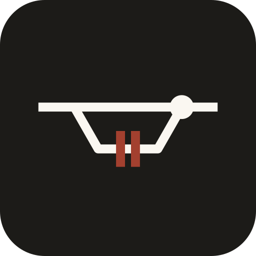

# po-kit

`po` is a small command-line tool for running a software backlog one item at a
time, with a gate, evidence and a clean git history. It scripts the mechanical
parts of a gated, one-item-one-commit workflow, so the people and coding agents
working the backlog run instruments instead of re-deriving the procedure each
time: open an item in its own worktree, stamp the gate's result, check the
branch is fresh, close the item (fast-forward, tag, record), and prune.

It suits a workflow with a product owner (a person or an agent) who opens and
closes items, and developers (people or agents) who each work one item in its
own branch and worktree. It is opinionated: one item is one commit is one tag.
See AGENTS.md for the dev/PO cadence, including the rule that an item changing behaviour updates or deletes the tests that pinned it.

Three laws, non-negotiable:
- **Dry-run is the default mode, not a flag.** Nothing writes without
  `--commit`; a full dry-run pass leaves `git status --porcelain` empty.
- **Manifest-driven.** Everything project-specific lives in the adopting
  repo's `po.toml`; the same scripts serve every project.
- **Never pushes, never writes prose.** The only words the kit ever edits
  are an item's STATUS tokens, wherever the backlog keeps them: a table
  cell, a status word in backlog prose, or a spec heading's status word.
  Close records, rulings, founding text and decisions stay human.

## Why it saves tokens

An AI coding agent pays for its whole working context on every step it takes:
each tool call re-sends the conversation so far, typically tens of thousands of
tokens, while the command's own output is a few hundred. So what a workflow
costs is mostly the **number of steps**, not the size of each step.

Done by hand, the boundaries of an item are many small steps: check the branch,
compare it with main, run each gate leg, count the tests, edit the backlog, commit,
fast-forward, tag, remove the worktree, delete the branch. Each one is a model
round trip, and each is a chance to get something slightly wrong (a missed status,
a mistyped tag, a hand-copied test count), which costs more round trips to notice
and repair. po turns each boundary into one command plus its dry run, with the same
result every time, and refuses instead of half-doing. The agent spends its steps on
the item itself.

How much that saves depends on your agent, model and context size. To measure it
for your setup, run one boundary twice on throwaway clones, once with po and once
by hand from the same instructions, and compare the two sessions' token counts.

## Requirements

- Linux (or WSL). bash 4.4 or newer, GNU coreutils (`stat -c`, `readlink -f`,
  `sort -V`) and a recent git (tested with git 2.56). Nothing else: no network, no services.
- macOS is not supported yet: its stock bash 3.2 and BSD tools differ. With
  Homebrew's `bash` and `coreutils` first on `PATH` it may work, untested.
- `python3` (3.8 or newer, standard library only) for `po serve`.
- `gtk4` and `python-gobject` (`pacman -S gtk4 python-gobject`) only for `po-dashboard`, the desktop viewer.
- `shellcheck` only to run the kit's own lint.

## Install

```sh
git clone https://github.com/MK-xOne/po-kit-for-ai-agent.git ~/src/po-kit
ln -s ~/src/po-kit/bin/po ~/.local/bin/po      # or: ~/src/po-kit/bin/po-install
po version
```

`bin/po-install [<tag>]` installs a tagged version in its own worktree and
points `~/.local/bin/po` at it, so work in progress on the kit's main branch
is never the live `po`.

## Quick start

1. Copy an example manifest to your repo root as `po.toml` and adjust it:
   `examples/rust.po.toml` (cargo) or `examples/python.po.toml` (pytest).
2. Keep a backlog table in `docs/BACKLOG.md` with an item column and a
   `Status` column (`TODO`, `DOING`, `DONE`, ...), and item specs whose
   headings read `## v1.2 — Title — STATUS` in `[layout] specs_dir`.
3. `po status` shows open items. `po open next "Title"` (dry run) shows what
   founding the next item would do; add `--commit` to do it. In the item's
   worktree, `po stamp` runs the gate and prints the evidence block;
   `po close <version> --commit` lands it.

## Usage

```sh
po [-C <repo>] [--manifest <file>] status [--idle <minutes>]
po [-C <repo>] [--manifest <file>] prune [--commit]
po [-C <worktree>] [--manifest <file>] stamp [--bin <path>]
po [-C <repo>] [--manifest <file>] fresh <version>
po [-C <worktree>] [--manifest <file>] report [--note <text>]...
po [-C <repo>] [--manifest <file>] open <version|next> [<title>] [--for <name>] [--epoch] [--body-file <f>] [--commit]
po [-C <repo>] [--manifest <file>] close <version> [--next <version> [--next-title <title>] [--for <name>]]
                                         [--also-done <version>]... [--body-file <f>] [--commit]
po [-C <repo>] [--manifest <file>] kickoff <version>
po [-C <repo>] [--manifest <file>] team [--json]
po [-C <repo>] [--manifest <file>] serve [--bind <addr>] [--port <n>]
po version
po doctor
bin/po-install [<tag>]
```

The manifest defaults to `po.toml` at the root of the repository's main
worktree; `examples/` has two to start from. po always works from the
main worktree and reads the backlog as committed on `main`, so it answers
the same from any worktree.

- `[layout] owner_column` — an optional manifest key naming a backlog table
  column (`"Owner"`, matched exactly like `Status`). Absent, every command
  behaves as before, byte for byte. Set, the owner of an item is the cell of
  that column in its table row: `po open` and `po close --next` use it for
  the admin subject's `… for <owner>` when `--for` is absent, a `--for` that
  differs from a non-empty cell refuses with exit 3 and writes nothing, an
  empty cell with no `--for` names no owner, `po status` prints `owner
  <name>` under each DOING and held item, and `po kickoff` prints an `owner
  <name>` line. A table without that column gives no owner; a header naming
  it twice is an error (2); an empty `owner_column` is a manifest error (2).
- `po status` — DOING and held (PAUSED/BLOCKED) items from the backlog
  tables and the spec-file headings, each with its branch (ahead/behind
  main) and worktree (dirty count); the latest tag; orphaned and dirty
  worktrees; unmerged branches no open item claims. Exits 3 when the
  backlog's sources disagree about an item.
  Each DOING item's branch line ends in `idle 3h12m`: now minus the newest
  of the branch tip's commit date, the newest `gate-<n>.txt`, and the
  newest mtime among the worktree's changed and untracked files (`idle -`
  with no worktree). `--idle <minutes>` also lists the DOING items idle
  longer under `IDLE (n)` and exits 8 after printing everything; without
  it the exit codes are unchanged (3 outranks 8). Read-only.
- `po ready` — the ready list from backlog status. Reads the repo's
  candidate file (`[ready] file` in po.toml, JSON lines
  `{item, title?, agents[], depends[], needs_note?}`; one repo may point at
  a shared file with a `project` field filtered by `[project] name`) and
  prints only items that can run now: the item's status on main is TODO (a
  DONE, DOING, HELD, PAUSED, BLOCKED item or an item absent from the backlog
  is never listed), every `depends` item is DONE, and `needs_note`, when
  present, names a repo path (a design note) that must exist on main; a line
  is later overridden by a corrected line for the same item (last wins).
  `--json` prints a JSON array; `--explain` prints per-candidate exclusion
  reasons to stderr. Exit 0 always for a readable list; a malformed line is
  reported with its line number and skipped. Read-only.
- `po prune` — worktrees and branches merged into main, minus the main
  worktree, open items' branches, and anything dirty, locked or outside
  `[layout] worktrees` (each listed with its reason). `--commit` removes
  them with `git worktree remove` (never `--force`) and a compare-and-delete
  of each branch ref.
- `po stamp` — runs the gate in the current worktree (`[gate.legs]` in
  order, or `[gate] command` as one leg), then `test_count_cmd`, and
  prints the evidence block:

  ```
  HEAD <sha> (<branch>)  dirty <n>
  gate PASS: check/test/clippy/fmt   tests <n> passed
  diffstat vs merge-base(main): <summary>
  prepare ran: <line>               # one per [stamp] prepare line
  bin sha256 <hash> (<path>)        # with --bin
  ```

  Optional `[stamp] prepare` lines run first (see below), so a format-only
  failure cannot happen.

  The count is the sum of every libtest `test result: ok. N passed` line
  `test_count_cmd` prints, and must equal the gate's own when the gate
  prints any. The block is also written to `gate-<n>.txt` at the
  worktree root, `<n>` one past the highest there; nothing is ever
  overwritten. All or nothing: a failing leg (named), a missing or
  disagreeing count, a non-ok summary, or a worktree that changed while
  the gate ran exits 4 and writes no file. `dirty` and that last check
  ignore the stamp files themselves; don't commit them.

  A failed run keeps its evidence outside the worktree. Its event (see
  `po events`) gives the failing leg a `tail`: the last 40 lines of that
  leg's output, each cut at 400 characters. The whole run's output (the
  reason, then every command that ran, under its command line and exit
  code) goes to `po-logs/stamp-<UTC time>-<item>-<pid>.log` in the
  repository's common git dir; the event's `log` key names it and stderr
  says where it is. Both are redacted first, best effort: the value of every
  environment variable whose name says it is a secret (`TOKEN`, `SECRET`,
  `PASSWORD`, `PASSWD`, `API_KEY`, `PRIVATE_KEY`, `ACCESS_KEY`, `CREDENTIAL`,
  `AUTH`, `NSEC`), is 8 characters or more and is not an absolute path, the value after a key of that
  kind (`token=...`, `password: ...`), an `Authorization` header's value
  (up to a quote or semicolon),
  `Bearer` and `Basic` credentials, a URL's user and password, tokens of
  well-known shapes (`ghp_`, `github_pat_`, `glpat-`, `sk-`, `xox?-`, `AKIA`,
  `nsec1`) and every line of a PEM private key become `[REDACTED]`, and
  terminal colour codes are dropped. A secret of no known shape under a name
  that does not say so passes through, so a gate should not print one. The
  event's `detail`, which names the failing leg's command, is redacted the
  same way. `po-logs/` is never pruned: po never deletes a log; remove old
  ones by hand.

  With `[gate] test_format = "pytest"` (default `"libtest"`) the count is
  instead the `N passed` of the last pytest summary line the output has
  (`223 passed in 1.23s`, `== 3 passed, 1 skipped in 0.5s ==`), counted per
  leg and cross-checked the same way. A summary naming `failed` or
  `error`/`errors`, or no passed tests, exits 4; so does output with no
  pytest summary.

  A line `RUN-ABORTED` in a leg's or the count command's output exits 4, and
  with `[gate] run_sentinel = "required"` so does a count command whose output
  has no `RUN-END ...` line (a test runner prints it last but for its summary).
  A count command that pipes the runner should keep the runner's exit code
  (`bash -o pipefail -c '...'`).
- `po fresh <version>` — the item branch (`[layout] branch`) against the
  local main: ahead/behind, the merge-base, and every main commit since
  it, oldest first, classed ADMIN (`admin_prefix`), ITEM vX
  (`item_commit` form) or OTHER, and marked RULING / RULES when it
  changes `[docs] decisions` / `rules`. Exit 0 and `FRESH` when main is an
  ancestor of the branch; exit 5 and `REBASE REQUIRED` when it is not.
  Read-only: it never fetches, rebases or writes. A remote-tracking main
  that differs from the local one is noted, not judged.
- `po close <version>` — the closing boundary. Pre-flight, all before any
  write: every backlog source says the item is DOING and none disagrees
  (else exit 3); its branch is exactly one item-form commit on main (6);
  `po fresh` passes (5); the newest `gate-<n>.txt` in its worktree names
  the branch tip, `dirty 0`, `gate PASS` (6); its tag is free (6). Then, with
  `--commit`: fast-forward main; a lightweight tag (written with
  `update-ref`, so `tag.gpgSign` never turns it into a signed one) or,
  with `[versioning] tag_style = "annotated"` (default `"light"`; any other
  value is a manifest error, exit 2), an annotated one (`git tag -a`, message
  `<tag>: <title>`, signing as the repo's git config says — po adds no `-s`;
  a tag that cannot be created stops the close there, naming what is owed),
  still create-only and at the item commit; the
  backlog edits as the `admin:` commit, author from git's own config, the
  stamp block quoted in its body (`--body-file` appends more); the
  `--next` item's branch and worktree at that commit; the closed item's
  stamp files, worktree (`git worktree remove`, never `--force`; kept and
  reported when it holds ignored files) and branch. `--next` takes a TODO
  item DOING, or with `--next-title` founds a new number (same law as
  `po open`); `--also-done` closes an investigation (DOING, no commits)
  in the same commit, with no merge and no tag.
- `[hooks] on_close` — an optional manifest command (`sh -c`) that
  `po close --commit` runs once the whole boundary is complete (ff, tag,
  admin, `--next`, prune), in the main worktree with stdin `/dev/null` and
  its output passed to stderr. Environment: `PO_HOOK=on_close`,
  `PO_VERSION`, `PO_TAG`, `PO_TITLE`, `PO_ITEM_COMMIT`, `PO_ADMIN_COMMIT`,
  `PO_DATE` (the admin commit's author date, ISO 8601), `PO_EVIDENCE` (a
  temporary file holding the stamp block, removed afterwards),
  `PO_BODY_FILE` and `PO_NEXT` (empty when not given), `PO_REPO`. A dry run
  lists the command and environment and runs nothing; a refusal or partial
  failure runs no hook. A non-zero exit warns and makes `po close` exit 7
  — the boundary stands, nothing is rolled back. No `[hooks]`, no change.
- `po report [--note <text>]...` — the item report, read-only, run in an
  item worktree. One markdown block: `<tag> report — <branch> at <short
  HEAD>`; `Files changed:` with a line per `git status` entry (code and path in backticks; stamp files left out) and, when the branch is ahead of main,
  the item commit's files marked `(committed)`; the newest `gate-<n>.txt`
  verbatim between fences; and `PROPOSED:` with each `--note` numbered, in
  order (the caller's words, passed through). Fresh stamp only: with no
  stamp, a newest one naming another HEAD or another dirty count, or any
  changed file newer than it, it exits 4 and prints nothing on stdout. It
  never runs the gate and posts nothing; the tag comes from the branch
  name via `[layout] branch`.
- `po events [--all] [--json]` — the gate event log, read-only. `po stamp`
  appends one event per run, pass or fail, and `po open` and `po close` one
  each after a complete `--commit`, to `po-events.jsonl` in the repository's
  common git dir (shared by every worktree, never tracked, never dirt).
  One JSON object per line: `time` (ISO 8601, UTC), `kind` (`stamp`, `open`,
  `close`), `item` (null off an item branch), `project` (the checkout's
  directory name), `result` (`pass`, `fail`), `agent` (`$BUZZ_AGENT`, else the
  user), `legs` (each leg's `name`, `result`: `pass`, `fail`, or `skip` when
  an earlier leg failed, and, on a stamp, `seconds`), for a stamp the run's
  own `seconds`, and `detail` (why a stamp failed). A failed stamp
  also has the failing leg's `tail` (its last 40 lines, redacted, one string
  with `\n` between lines) and `log` (the absolute path of the run's full
  output, null when it could not be written); see `po stamp`. Logging never
  changes a command's exit status or output; a log that cannot be written
  warns on stderr. `po events` prints the last 10, newest first, as a table
  in the viewer's local time, then, under it, each listed failed stamp's
  tail, indented, under a line naming the leg and the log; `--all` prints
  every event; `--json` prints the stored lines (UTC) for machines; the two
  combine.

  **Time taken.** A stamp event records whole seconds of wall clock: each
  leg's `seconds` (from the leg starting to its exit; a leg not reached has
  `seconds` 0; the `prepare` leg is the time of its lines) and, after `legs`,
  the run's `seconds` (prepare plus legs; the test-count command is in the
  run, not a leg). Older events, and open and close events, have no
  `seconds`: every reader treats that as unknown, never 0. `po events` adds a
  `TOOK` column (`57s`, `4m12s`, `1h02m03s`, `-` when unknown), shows each
  leg's time after its result (`test:pass(4m09s)`; no suffix when unknown),
  and prints the word `slow` after the time of a run over `[stamp]
  slow_after`; `--json` carries the raw keys. The mark is information only:
  no exit code changes. **The trigger:** when a gate goes over about 5
  minutes (the `slow` mark), the PO specs a fast per-item gate and runs the
  full suite nightly and before each release. Those tiers are not built.
- `po open <version|next> [<title>]` — the founding boundary. A new number
  must be latest founded + 1 (`next`), an epoch step with `--epoch`
  (1.10.0, 2.0.0), or the next insert in the `insert_segment`-th segment
  under a founded item; its heading `## <tag> — <title> — DOING` goes into
  the spec file of the closest lower version, before the first higher
  heading. A number already founded TODO goes DOING. With `--commit`: the
  edits as the `admin:` commit, then the branch and worktree at it.
- `po kickoff <version>` — the mechanical half of a founding brief,
  read-only. The item's spec section verbatim from main, between
  `SPEC SECTION <file>:<a>-<b>` and `END SPEC SECTION`: from its heading
  to the next heading of the same or a higher level (fenced code is not
  read for headings). The heading is the `## <id> — …` one the backlog
  parser reads; failing that, in a table-shaped ledger, any heading
  naming `item <label>`, the label being a cell left of the id in the
  item's table row (`| E | v0.5 |` finds `### … (item E — …)`). Every
  matching heading is printed. Then the `[docs] rules` pointer (its blob
  on main), and every admin or ruling commit on main from the previous
  boundary — the highest tag below the item reachable from its founding —
  to its founding, the oldest first-parent commit where a backlog source
  says DOING; each line is `po fresh`'s for that commit. An item not yet
  DOING is listed to main's tip; an open one also lists what main gained
  since its founding. The judgment layer stays the PO's. Exit 2 when a
  source is missing: no spec section (a founding in progress), no
  `[docs] rules`, or one not on main.
- `[kickoff] preamble` — an optional manifest key, a one-line array of
  strings (`preamble = ["Run pwd first.", "", "Read the rules."]`; an empty
  string is a blank line). `po kickoff` prints its lines verbatim at the very
  top of the brief, then a blank line, so a project's start-of-item steps are
  part of the prompt. Absent or `[]`, the output is byte-identical to before.
  A value that is not an array of quoted strings, or any other key under
  `[kickoff]`, is a manifest error (2); `po doctor` lists the key as
  `adopt [kickoff] preamble` for a manifest without it.
- `[close] checklist` — an optional manifest key, a one-line array of strings
  (`checklist = ["Post the close message.", "Propose the episode."]`), the
  steps a project wants after every close. After a complete `po close
  --commit` boundary, before any `[hooks] on_close` command, po prints the
  lines under a `CHECKLIST` heading. With `--run-checklist` it also runs each
  non-blank line (`sh -c` in the main worktree, stdin `/dev/null`, output to
  stderr, `PO_VERSION`, `PO_TAG`, `PO_TITLE` and `PO_REPO` set), every line
  even if one fails; a failure is a warning and exit 7, the boundary stands.
  The dry run lists the checklist and runs nothing. Absent or `[]`, `po close`
  behaves exactly as before (and `--run-checklist` is a usage error without
  one). A value that is not an array of quoted strings, or any other key under
  `[close]`, is a manifest error (2); `po doctor` lists the key as
  `adopt [close] checklist` for a manifest without it.
- `[stamp] prepare` — an optional manifest key, a one-line array of
  strings (`prepare = ["cargo fmt", "ruff format"]`), the deterministic
  fixes (formatters) a project wants applied before every gate. `po stamp`
  runs each non-blank line in order (`sh -c` in the worktree, stdin
  `/dev/null`) before anything else, then takes the worktree's state, so
  `dirty` and the unchanged-tree check count what the lines changed, and
  the gate tests the formatted tree. The block names each line that ran
  (`prepare ran: <line>`, after the diffstat); the event records them as one
  leg, `prepare`, ahead of the gate's legs. Test summaries a line prints
  are not counted. A line that exits non-zero fails the stamp like a gate
  leg: exit 4, nothing written, later lines and the gate not run, the
  `prepare` leg failed with its tail (the output of every line so far) and
  the full output in the stamp log. Absent or `[]`, `po stamp` is
  unchanged. A value that is not an array of quoted strings, or any key
  under `[stamp]` other than `prepare` and `slow_after`, is a manifest error
  (2); `po doctor` lists the key as `adopt [stamp] prepare` for a manifest
  without it.
- `[stamp] slow_after` — an optional integer, seconds (default 300): a stamp
  run that took longer is marked `slow` in `po events` and in the
  dashboard. Information only.
- The backlog edits both make are status words only — a spec heading's
  status word, a table row's Status cell, the one status word after the
  item's id in BACKLOG prose (`v1.9.11 parser TODO` → `DOING`; a close
  writes `DONE (tag vX)`) — plus a founding heading line. Each is anchored
  on the id and the status it expects; two candidates, another status or a
  status wrapped onto the next line stop with exit 3. Prose (close records,
  rulings, founding text) stays the PO's. Without `--commit` both print the
  whole plan — steps, the edits as a diff, the admin message, `--commit`
  readiness — and change nothing. Exit 6: refused by the item law.

- `po team [--json]` — the feed the dashboard Team view reads
  (`--team-url`, below), built from what the kit knows, read-only. The roster is
  the manifest's `[[team.agent]]` tables, in file order: `name` (required,
  unique, matched without regard to case), optional `model` and `role`. Per
  agent it prints `{agent, model?, state, now, owns[], free, limit_until?,
  usage?}` (`--json`: one JSON array; otherwise a table). `state` is
  `WORKING`, or `idle <time>` (`22m`, `3h`, `2d`; `idle never` with no event)
  from the age of the agent's newest event in the gate event log (`BUZZ_AGENT`
  or the user name is the event's agent). `owns` is the open items (DOING,
  PAUSED, BLOCKED) whose `[layout] owner_column` cell names the agent, by
  version; without that key nobody owns anything. An agent is `WORKING`, with
  `now` its lowest-numbered DOING item, while it owns a DOING item and its
  newest event is under 15 minutes old. `free` is true for an agent that is
  not WORKING and either owns nothing, or has been idle 15 minutes or more
  with every owned item held (PAUSED or BLOCKED, waiting on someone else);
  an agent with a DOING item is never free. Host facts are not probed:
  `[team] limits_file` (a JSON object, agent to an ISO time or `null`) and
  `usage_file` (agent to `{five_hour, seven_day}`, numbers) are merged into
  `limit_until` and `usage` when the files exist; a missing file is ignored,
  an unreadable one warns on stderr and is left out (both need `python3`;
  paths are relative to the main worktree). An empty roster is an error (2).
  `po serve` exposes the same array at `/team.json`. `examples/team.po.toml`
  is a sample roster.
- `po dispatch --plan | --commit` — gives the ready items to the free eligible
  agents. For each item of `po ready --json`, in that order, the first agent of
  `po team --json` that is `free` and eligible gets it: an item whose `agents`
  list is non-empty is eligible only to those names (case-insensitive), one
  with no list to any roster agent. Candidates are tried in the order of
  `[dispatch] order` (a one-line array of names, cheapest first; agents not
  named come after, in roster order). An agent gets at most one item per run,
  and an agent that is not free (WORKING, or owning an item) never gets one.
  `--plan` prints one `assign <item> to <agent>` or `skip <item> <reason>` line
  per ready item (`no free eligible agent`, `no roster agent is eligible`) and
  changes nothing. `--commit` runs `po open <item> --for <agent> --commit` for
  each assignment with `BUZZ_AGENT=dispatcher`, so the open events carry the
  agent `dispatcher` (a fixed name); a failed open is reported (`FAILED`) and the
  run goes on, then exits 6. After each open it writes the item's prompt (a
  first line `<item> → <agent> · PROMPT`, then `po kickoff`) to
  `<git dir>/po-dispatch/<item>.md` and runs the optional `[dispatch] notify`
  command (`sh -c`, in the main worktree) with three arguments: the item, the
  agent and the prompt path; the kit knows no chat, a wrapper command posts
  the message. A second run finds the opened items DOING and opens nothing
  twice. `po open <item> --for <agent>` writes the agent into the item's
  empty `owner_column` cell in its own admin commit (a cell already naming
  another agent is refused, exit 3), so `po team` sees the agent as busy and
  a repeated run gives no agent a second item. Needs `python3`.
- `po serve [--bind <addr>] [--port <n>]` — a small read-only web viewer of the
  gate events, for a screen you leave open. `/` shows the last 10 events, newest on top,
  one row each: result (symbol and word), item, project, kind, checks (each
  gate leg and its result), agent, took (the run's time, `-` when unknown,
  in the warning colour when over `[stamp] slow_after`; `po serve` reads the
  threshold from po.toml, `PO_SLOW_AFTER` sets it for `po-dashboard`, default
  300), time, and a note icon when the event has a
  detail (its tooltip and aria-label are the detail, then, for a failed
  stamp, the failing leg's tail and the log's path); each row links to `/all`,
  the full list, in the same layout; `/events.json` is the same data as JSON, and `/team.json` is `po team --json`. The pages poll it every
  few seconds and redraw in place; times are UTC in the data and shown in the
  browser's local time. Every field is HTML-escaped. It reads events only by
  running `po events --json` (so it needs a po that has `po events`) and needs
  `python3` (standard library only). GET only: any other method is 405. It binds
  `127.0.0.1` (port 8765) unless told otherwise, and refuses `0.0.0.0`, `::` and
  any name that resolves to them (exit 1): name one address, e.g. a VPN
  interface's. There is no login, so bind only to an address whose reachers you
  trust. It prints `po serve: listening on http://<addr>:<port>/` and runs until
  stopped; `--port 0` picks a free port.
- `po-dashboard [--url <url>] [--team-url <url>] [--decisions-url <url>] [--projects-url <url>] [--view events|team|decisions|projects|reports] [--project <name>] [--theme auto|light|dark] [--all] [--size WxH] [--check] [--screenshot <png>] [--screenshot-delay <s>]`
  (`bin/po-dashboard`, not a `po` subcommand) — a desktop window for the same
  events: the last 10 as soft raised single-line cards (result, item, project,
  kind, checks, agent, took (sortable like the others; `-` when unknown,
  the warning colour when slow), time in the local zone, note) in fixed columns that line
  up from card to card, long values ellipsized with the full text as a tooltip,
  the project and checks columns widening with the window, and a note icon for
  an event with a detail (tooltip and accessible label are the detail, with
  a failed stamp's tail and log path as in `po serve`; an
  event without one leaves the slot empty), a "Show all" toggle for every event (in the
  second button row, below), a
  refresh every 5 seconds. The URL is the events JSON, for example the
  `/events.json` of a `po serve`; `--url` or `PO_DASHBOARD_URL`, with no
  default, and neither is an error (exit 1). It accepts a JSON array or one
  object per line. An unreachable URL shows an error line and keeps the last
  data. The window has the desktop's own title bar and a neumorphic style (GTK
  CSS, one base colour per variant); pass and fail carry a symbol and a word
  as well as a colour, text and status colours meet WCAG AA (4.5:1), and the
  light or dark variant follows the desktop's setting (`--theme` overrides it).
  Needs GTK 4 and PyGObject (`pacman -S gtk4 python-gobject`; exit 2 without
  them); the logic is `lib/po/dashboard_core.py`, which needs neither.
  `--team-url` or `PO_DASHBOARD_TEAM_URL` (no default; `--team-url` wins) adds a
  Team view, a header toggle Events | Team: one line per agent from a JSON
  array of `{agent, model?, state, now, owns[], free, limit_until?, usage?}`
  (name, then the optional `model` string in muted text, nothing when absent;
  one Status column, then the `now` item and the `owns` items). Status is
  `LIMIT until <time>` (in the viewer's local time, with the date when not
  today; red; it wins over the rest) while `limit_until`, an ISO time, is still
  ahead (null, absent, past or unparseable is no limit); else `state` as given
  with a live dot when it starts with WORKING; else a FREE badge when `free`;
  else `state` in muted text (`idle 22m`). `usage` is
  `{five_hour, seven_day}`, each 0-1, shown after the status as muted
  percentages (`5h 42% · 7d 18%`), only the parts present; old feeds without
  `limit_until` or `usage` show as before. It is refreshed with the events; a failed fetch keeps the last
  team data and says so. The feed is an http(s) URL or a file
  (`examples/team-feed.json` is a sample); without the option there is no
  toggle; `--view team` starts in it. Drag a Team line onto another to take its
  place, or press Alt+Up/Down on a focused line; the order is saved on the
  viewer's machine in `$XDG_CONFIG_HOME/po-dashboard/team-order.json` (default
  `~/.config`; `PO_DASHBOARD_TEAM_ORDER` names another file), applied on every
  refresh and at start, and `--check` uses it too. Agents not in the saved order
  go last, in the feed's order; a missing or broken file is no order; the feed
  itself is never written.
  `--decisions-url` or `PO_DASHBOARD_DECISIONS_URL` (no default;
  `--decisions-url` wins) adds a Decisions view to the same header toggle
  (Events | Team | Decisions, each shown only when its feed is set): items
  waiting on a decision, from a JSON array of `{project, item, title,
  waiting_for, asked_at, thread_url?, asked_by?}`, collapsed to one line per
  entry (project, item, short title, when; `asked_by`, when present, shown
  muted), click expands the full `waiting_for` wrapped with line breaks, click
  again collapses. Oldest `asked_at` first (entries without a readable one
  last). `asked_at` is shown relative
  ("3h ago"), its local time in the tooltip; `thread_url`, when present, is
  muted text you can select and copy, never opened from the window. Refreshed
  with the events; a failed fetch keeps the last decisions data and says so.
  An entry you expand stays open across refreshes (until it leaves the feed).
  The view is read-only. The feed is an http(s) URL or a file
  (`examples/decisions-feed.json` is a sample, and the demo server serves it at
  `/decisions.json`); `--view decisions` starts in it.
  An entry may carry a `kind`, `"choice"` or `"action"`, and then a required `id` (stable,
  unique per ask). A **choice** has `question` and `options` (2 or more of
  `{label, description?, recommended?}`, at most one `recommended`, listed in feed order
  with the recommended one marked, never reordered); an **action** has `machine`, `steps`
  (`{text, command?}`, numbered, a `command` in its own selectable block with a Copy
  button that only puts it on the clipboard) and `done_when`. `waiting_for` stays required
  for every kind. Each kind has a badge and colour (Choice the accent, Action the `warn`
  colour); a `kind` entry with an unknown kind, a missing `id` or a missing or malformed
  field shows as `unformatted` in the error colour, so it stays visible. An entry without
  `kind` displays as before. Order: Choices, then Actions, then unformatted and legacy,
  each group oldest first. An `Actions` toggle in the second button row (on by default)
  hides the Action entries and the status line says `3 waiting · 1 action hidden`; its
  state is saved on the viewer's machine in `$XDG_CONFIG_HOME/po-dashboard/decisions.json`
  (`{"actions": false}`; `PO_DASHBOARD_DECISIONS_FILTER` names another file; a missing or
  broken file means on). `--answer-url` or `PO_DASHBOARD_ANSWER_URL` (no default; the flag
wins over the environment) sets an http(s) answer sink: when it is set, expanded decision
cards gain pick controls and a Send button (see below). Without it the view stays
read-only and the status line says `read-only` once when the view opens. The bearer token
for the POST is read only from `PO_DASHBOARD_ANSWER_TOKEN` (never a flag). Esc closes the
window. `--check` prints the rows the window would show, without a
  display (`--all` for every event, then the team lines when a team feed is set, then the
  decisions lines (the kind first, `legacy` for no kind; the Actions filter is ignored) when a decisions feed is set, then one line per project when a
  projects feed is set; exit 2 when a URL is unreachable);
  `--projects-url` or `PO_DASHBOARD_PROJECTS_URL` (no default; `--projects-url`
  wins; an http(s) URL or a file, like the team feed) reads the projects feed, refreshed
  with the events; a failed fetch keeps the last projects data and says so. The feed is
  a JSON array of `{project, last_event?, items: [{item, title?, status, agents: []}]}`:
  `last_event` is an ISO time or null; `status` is the item's po status word: TODO,
  DOING and DONE, with PAUSED and BLOCKED counted as DOING, and any other word (HELD)
  listed under All only and counted nowhere; `agents` are the names tied to the item,
  in order, filled by the producer of the feed: for TODO the agents that could take it,
  for DOING the one working now, for DONE every agent involved, first event to last.
  A project's light is `active` when its last event is at most 30 minutes old, `idle`
  at most 24 hours old, else `inactive` (null, unreadable or in the future beyond a
  minute is `inactive`). The kit defines the shape only; the producer is yours.
  `examples/projects-feed.json` is a sample, and `examples/events-demo-server.py`
  serves it at `/projects.json` with fresh times. `--check` prints
  `name | light | todo/doing/done` per project.

  Answering decisions (v0.49). When `--answer-url` (or `PO_DASHBOARD_ANSWER_URL`)
  is set to an http(s) URL, each expanded decision card below the fold gains Send
  controls, and the dashboard POSTs one JSON object per answer there. The bearer
  token is read only from `PO_DASHBOARD_ANSWER_TOKEN` (env only, never a flag).
  The body is:
  ```
  {"answer_id": "<uuid4>", "id": "<entry id>", "project": "<name>", "item": "<num>",
   "kind": "choice"|"action"|"unformatted", "option": "<label>"|null, "text": "<str>"|null,
   "result": "pass"|"failed"|null, "step": <n>|null, "note": "<str>"|null,
   "answered_at": "<utc iso8601>", "client": "po-dashboard"}
  ```
  `answer_id` is a uuid4 made once per Send and kept with the draft, so Retry
  re-posts the same body. The card controls differ by kind:
  - **Choice** — one radio row per option plus an `or write your own` text box;
    Send is enabled once an option is chosen (the text, if any, travels along).
  - **Action** — `Pass` and `Failed` buttons; Failed opens a step chooser (the
    step numbers) and a one-line note box; Send is enabled once a step is chosen
    (for Pass, immediately).
  - **Unformatted** — a free-text box; Send is enabled once it is non-empty.
  No Enter-to-send, no confirmation dialog. The POST runs in a worker thread and
  never blocks the UI; the answer state is kept in the window state keyed by
    `id`, re-applied on rebuild, pruned when the entry leaves the feed. The card
    shows the result:
  | HTTP | state |
  |---|---|
  | 200 / 201 | `answered · sent` (muted; controls disabled) |
  | 409 | `already answered` (controls disabled) |
  | 404 | `no longer waiting` |
  | 401 / 403 | `refused by <host>: <code>` (Retry) |
  | other / no connection | `not sent: <reason>` (Retry) |
  Each failing state shows a Retry button that re-posts the same body. `examples/events-demo-server.py`
  serves a `POST /answers` handler for manual testing: 201 the first time it sees an
  `answer_id`, 200 for a repeat, 404 for a missing id, 401 without a bearer token.
  The **Projects** view (the fourth button of the header toggle, shown only when a
  projects feed is set; `--view projects` starts in it, and exits 1 without a feed) is a
  grid of rectangular cards, one per project in the feed's order, wrapping to the window
  width. A card shows a status light (a filled circle: green `active`, yellow `idle`, red
  `inactive`), the project name, and the counts `TODO`, `DOING` and `DONE`. The light is also
  spelled out in the card's tooltip and accessible label ("orchard, active, TODO 1, DOING 1,
  DONE 1"), so colour is not the only signal. Cards take Tab focus; clicking one, or Enter or
  Space on it, opens that project's screen. An empty feed shows "no
  projects"; a failed fetch keeps the last cards and says so. A refresh that changes nothing
  leaves the cards alone, and one that does keeps the scroll position and the focused card.
  The **project screen** replaces the cards: a header with a Back button (Escape does the
  same; the overview keeps its scroll and the project's card takes the focus back), the
  project name and its light; filter buttons All, TODO, DOING and DONE, each with its
  count (All at start; the choice is kept across refreshes and per project while the window
  is open); and one row per item in the feed's order: item id, title, status badge and its
  agents, as the feed gives them. TODO rows list the agents that could take the item, DOING
  rows the agent working now (with the live dot of the Team view), DONE rows every agent
  involved in order; none is a muted dash. A refresh rebuilds the rows without resetting
  the filter or the open project, and a project that leaves the feed returns to the
  overview. `--project <name>` with `--view projects` opens straight on that screen.
  `--view projects --screenshot <png>` (add `--project orchard` for a project screen)
  saves the pane once the feed has loaded. Light and
  dark themes use the dashboard's palette.
  `--all` also starts the window with Show all on, `--size WxH` sets its size,
  and `--screenshot` saves the window to a PNG once it has data (after
  `--screenshot-delay` seconds, 0.6 by default), then quits.
  In the Events view a second, thinner row of buttons sits under the header: "Show all"
  and "Reports". The row is hidden in Team; in Decisions it holds only the "Actions" toggle; the view buttons never move.
  "Reports" swaps the list for a report pane (a title, a time-range choice 24 h / 7 d / 30 d,
  7 d by default, and five charts; "no events in this range" when the range holds none);
  "Reports" again returns to the list. The charts (the numbers come from `lib/po/dashboard_reports.py`,
  no GTK; drawn with GTK's own snapshot API, no drawing library to install): gate runs per agent, one
  row per agent with stacked pass (solid) and fail (hatched) bars per bucket, hourly for 24 h and daily
  for 7 d and 30 d, busiest agent first; an empty bucket is not drawn (a muted note under the chart counts the hidden days or hours), each bar shows its count above and its date or hour below, a line under the title says "each bar = one day" (or hour), and every axis top is the closest round step above the highest value, so bars use the height; first-try pass rate per agent, the share of items whose first
  stamp (per project, item and agent) passed, a horizontal bar with the percentage and n; items closed
  per day, stacked by project with a legend (a project past the palette's six colours reuses one,
  hatched); item cycle time per agent, a box plot of the time from an item's open event to its
  passing close event (whisker min to max, box first to third quartile, a bar at the median, then the
  median and n; items not yet closed, or with no open event in the feed, are left out, and an item
  counts for the agent that stamped it most, else the agent of its close event); failed legs by kind
  over time, the failed legs of the events counted per leg name per bucket (hourly for 24 h, daily
  otherwise), stacked, the six leg names with most failures in the range each with a colour and the
  rest grouped as "other" (hatched grey, last). Colours come from the dashboard theme, light and dark; each chart is an image for assistive
  technology whose label, also its tooltip, is the numbers as a sentence. Days and hours are in the
  viewer's time zone. The charts read these fields of each event in the feed: `kind`, `item`,
  `project`, `result`, `agent`, `time` and `legs` (a list of `{name, result}`); `examples/events-demo-server.py`
  serves enough open, stamp and close events to show all five. `--screenshot` with `--view reports` saves the pane. The range and the pane
  survive the 5-second refresh. `--view reports` starts in the pane.
  The Events and Team lists have a header line of column titles in muted text
  (same widths as the rows, so each sits over its data). Each is a button
  (accessible label "sort by <column>"): a click sorts the rows by that column
  ascending, a second click descending, a third returns to the default order
  (newest first for Events, the saved drag order for Team); an arrow marks the
  active column and direction. Time sorts by instant, numbers inside text
  ("1.9" before "1.11") by value, other text without regard to case. The sort
  holds across refreshes, is never written to the saved Team order, and a Team
  line cannot be dragged while a column sort is on. The Decisions view has no
  headers. `--screenshot` shows the headers.
  An event that appears while the Events view is open starts with its card 25%
  darker (25% lighter in the dark theme) and eases back to the normal card
  colour over 60 seconds, text colours adjusting to stay AA at every step;
  events there when the window opens, and every event after a switch back from
  Team, start normal. With the desktop's animations off (reduced motion) the
  highlight stays at full strength and drops after 60 seconds. The pages of
  `po serve` do the same (a CSS animation; `prefers-reduced-motion` keeps the
  highlight without animating). `examples/events-demo-server.py` is a sample
  feed that adds an event every 15 seconds to watch it on.
  Run `bin/po-dashboard-install` to add a po-dashboard entry to the desktop
  application menu and install its icon theme files; `--prefix <dir>` installs
  under a directory for testing, `--uninstall` removes exactly what it wrote.
- `po version` — the tag this po-kit checkout is at (`git describe --tags
  --exact-match`; else `git describe --tags --always --dirty`). Works from
  anywhere, reads no manifest.
- `po doctor` — read-only, for every repository (an absolute path, or `~/…`)
  listed in `~/.config/po-kit/adopters` (one per line; blank lines and lines
  starting with `#` skipped): reads its `po.toml` with this po's reader
  (`manifest ok` or `FAIL` with the reader's message), runs `po -C <repo>
  status` (`ok`, also for exit 3 and 8, which are reports; any other exit
  `FAIL`), and lists each optional manifest key the adopter does not set as
  `adopt [section] key`. Exit 2 when any adopter fails or the list is
  missing; `--manifest` does not apply. The kit never edits an adopter's
  `po.toml`: turning a key on is that project's admin commit.
- `bin/po-install [<tag>]` — makes a po-kit tag the live `po`, so main's
  half-done changes never are. The tag (default: the newest `v<number>`) is
  checked out with `git worktree add --detach` under
  `~/.local/share/po-kit/<tag>` (an existing one is reused only when clean
  and at that tag) and `~/.local/bin/po` is pointed at its `bin/po`
  atomically; it prints `old -> new`. Refuses (exit 6) a branch or unknown
  name, a dirty install directory, a non-symlink at `~/.local/bin/po`, and a
  tag whose `po -C <adopter> status` exits 2 for an adopter the installed po
  reads without exit 2 — the symlink stays and a worktree it just made is
  removed. After switching it runs `po doctor` (skipped, with a note, when
  there is no adopters list or the tag predates `po doctor`); a failing
  doctor exits 7, the switch standing. It never pushes. In po-kit's own
  `po.toml`, `[hooks] on_close = "bin/po-install \"$PO_TAG\""` runs it at
  each close.

## Development

Tests: `tests/run.sh` (throwaway repos in a temp dir). The runner fails loudly when a block dies: it ends with a `RUN-END` line (or prints `RUN-ABORTED` and exits non-zero), and `[gate] run_sentinel = "required"` makes `po stamp` refuse a test count from a run that has no `RUN-END`. Lint:
`shellcheck -x bin/po bin/po-install lib/po/*.sh tests/run.sh`.
`AGENTS.md` is a short guide for coding agents that use po;
`CHANGELOG.md` lists what each release changed.

## License

MIT; see `LICENSE`. Provided as-is.
